# Lab 10 – Add Your Own System Call: trace

Course: Operating Systems, FCIM / FAF, UTM, 2026-2027. Track B: build your own small OS (xv6).

This page explains everything that was done in the lab, step by step: every edit, every command, what it printed, and why. The figure numbers are the same as in the Word report, so the two can be read side by side.

## What is in this folder

This is the first lab that changes the **kernel**, so the folder keeps the layout of the xv6 tree: `kernel/` and `user/` hold the files exactly as they are in my tree after the lab.

| File | What it is |
|---|---|
| `Lab10_EftodeAndrei_FAF-242.docx` | The report: title page, 32 screenshots, the answers to every Observe box and the optional part |
| `kernel/syscall.h` | The numbers of the system calls, with `SYS_trace 23` (and `SYS_sysinfo 24`) |
| `kernel/syscall.c` | The table number → function, the table of names, and the print after each call |
| `kernel/sysproc.c` | The handlers `sys_trace` (and `sys_sysinfo`) |
| `kernel/proc.h` | `struct proc` with the new field `trace_mask` |
| `kernel/proc.c` | `kfork()` copies the mask to the child (and `nproc()` for the optional part) |
| `kernel/kalloc.c`, `kernel/defs.h`, `kernel/sysinfo.h` | Optional part: `freemem()`, the two declarations, `struct sysinfo` |
| `user/trace.c` | The program `trace mask command...` (exactly the code of the sheet) |
| `user/user.h`, `user/usys.pl` | The user side: declaration and stub of `trace` (and `sysinfo`) |
| `user/sysinfo.c` | Optional part, written by me: prints free memory and processes in use |
| `Makefile` | The xv6 Makefile with `$U/_trace\` (and `$U/_sysinfo\`) in `UPROGS`, plus the lines of Labs 4, 6 and 8 |
| `user/sleep.c`, `args.c`, `mystat.c`, `find.c`, `run.c`, `pingpong.c`, `primes.c` | My programs from Labs 4, 6 and 8, unchanged, because this Makefile builds them too. With them the folder builds on its own |
| `lab10.patch` | The three Lab 10 commits of my tree (`git format-patch`): the exact changes, line by line |
| `notes.txt` | The answers the sheet asks to write "in notes.txt" |
| `full_explanations.md` | The slow version of this page: the whole path of a system call in xv6, every edit explained, the bit masks, worked examples and a self-test |
| `screenshots/` | The terminal screenshots shown on this page (`fig-1-1.png` is Figure 1.1, and so on) |

## How to run it

```bash
# a fresh xv6 at the course revision
git clone https://github.com/mit-pdos/xv6-riscv.git && cd xv6-riscv
git checkout 06aad25
# put this folder over it (the paths match the tree)
cp -r <this repo>/lab10/kernel <this repo>/lab10/user <this repo>/lab10/Makefile .
make qemu
# at the xv6 prompt:
#   trace 32 grep hello README
#   trace 2147483647 grep hello README
#   trace 2 usertests forkforkfork
#   trace 65536 echo hi
#   sysinfo
# leave xv6: press Ctrl-A, release, then press X
```

On a tree that already has my Labs 4, 6 and 8 (branch `lab`), `git am lab10.patch` applies the three commits instead.

## Words used on this page

- **xv6**: a very small teaching operating system from MIT, running inside **QEMU**, a program that pretends to be a RISC-V computer. `make qemu` builds xv6 and starts it.
- **Two prompts.** `vboxuser@os:~/xv6-riscv$` is bash on Linux. A lonely `$` is the xv6 shell.
- **Kernel and user**: the files in `kernel/` are the operating system itself; the files in `user/` are programs that run on it (`ls`, `grep`, my `trace`). A user program can only ask the kernel for things through system calls.
- **System call number**: the kernel knows its calls by number: `read` is 5, `write` is 16, `sync` is 22. The new `trace` gets 23.
- **`ecall`**: the RISC-V instruction that jumps from a user program into the kernel. Before it, the number of the call goes into register **`a7`**, the arguments into **`a0`**, `a1`...; the result comes back in `a0`.
- **Stub**: the three instructions that do this (`li a7, SYS_trace`, `ecall`, `ret`). They are generated from `user/usys.pl`.
- **Mask**: a number read bit by bit. Bit N on (= 1) means "print system call number N". 32 = 2^5 has only bit 5 on, and 5 is `read`.
- **`printk`**: the kernel's own print function (the kernel cannot use the `printf` of user programs). In older xv6 versions it was also called `printf`; the sheet warns about that.

## Before the lab

```bash
cd ~/xv6-riscv
git status
git log --oneline -4
git diff --stat 06aad25 HEAD
tail -n 2 kernel/syscall.h; grep -n "int sync" user/user.h; grep -n "printk(" kernel/defs.h
```

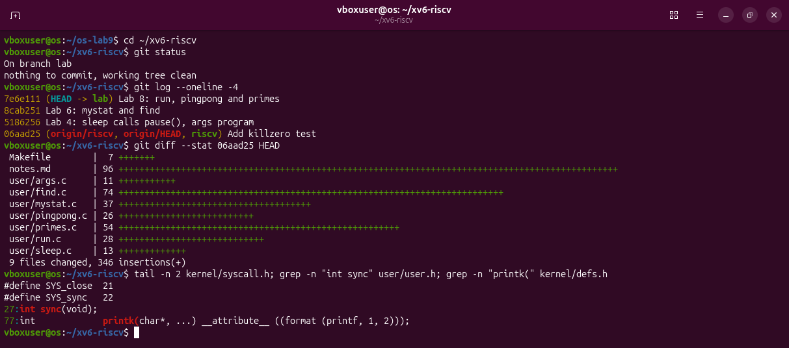

- The tree is clean, on branch `lab`, at my Lab 8 commit.
- `git diff --stat 06aad25 HEAD` lists everything I changed since the course revision: only `Makefile`, `notes.md` and my programs in `user/`. **No file in `kernel/`**: the kernel is still the original one.
- The sheet's warning is true for this tree: the last number is `SYS_sync 22`, so `trace` must be 23 (the MIT page on the internet says 22), and the kernel print function is `printk`.

```bash
make qemu
```

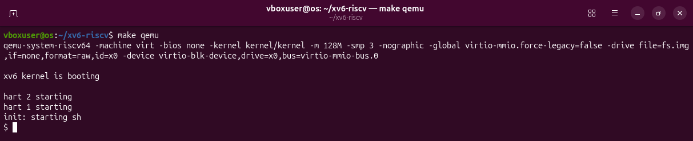

It boots to the xv6 prompt `$`. Ctrl-A then X stops QEMU.

## Part 1 – The number and the user side

Five small edits. I made each one in nano, opened at the right line (`nano -l +24 kernel/syscall.h` opens the file at line 24 and shows line numbers).

### 1.1 kernel/syscall.h: the number

```c
#define SYS_sync   22
#define SYS_trace  23      // new
```

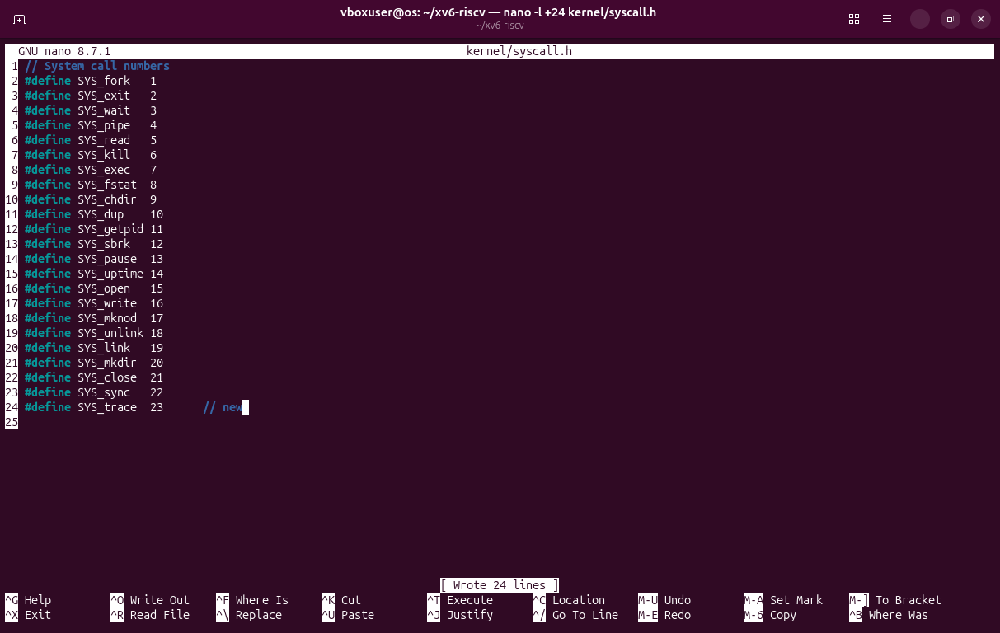

The kernel and the stub both include this file, so they agree that 23 means `trace`.

### 1.2 user/user.h: the declaration

```c
int sync(void);
int trace(int);         // new
```

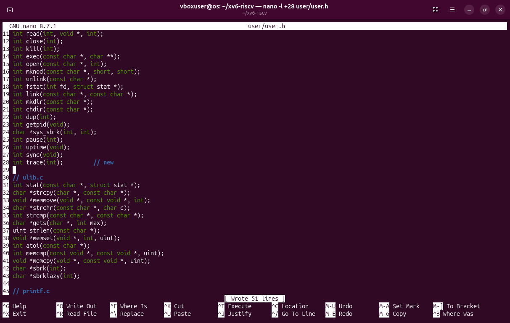

User programs include `user/user.h`. Without this line, `trace(...)` in `trace.c` would not compile (with `-Werror`, an undeclared function is an error).

### 1.3 user/usys.pl: the stub

```perl
entry("sync");
entry("trace");         # new
```

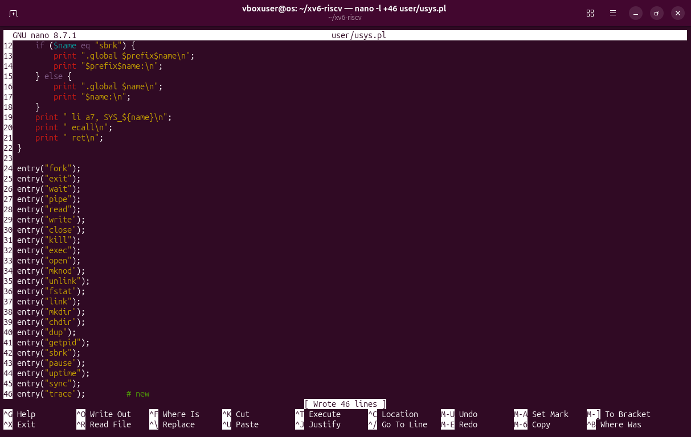

`usys.pl` is a small Perl script. At build time it writes `user/usys.S`, with one stub per `entry(...)` line (lines 12-21 of the figure show how: `.global name`, `name:`, `li a7, SYS_name`, `ecall`, `ret`).

### 1.4 user/trace.c: the program

```c
#include "kernel/types.h"
#include "kernel/stat.h"
#include "user/user.h"

int
main(int argc, char *argv[])
{
  if (argc < 3) {
    fprintf(2, "usage: trace mask command [args...]\n");
    exit(1);
  }
  if (trace(atoi(argv[1])) < 0) {
    fprintf(2, "trace: failed\n");
    exit(1);
  }
  exec(argv[2], argv + 2);
  fprintf(2, "trace: exec %s failed\n", argv[2]);
  exit(1);
}
```

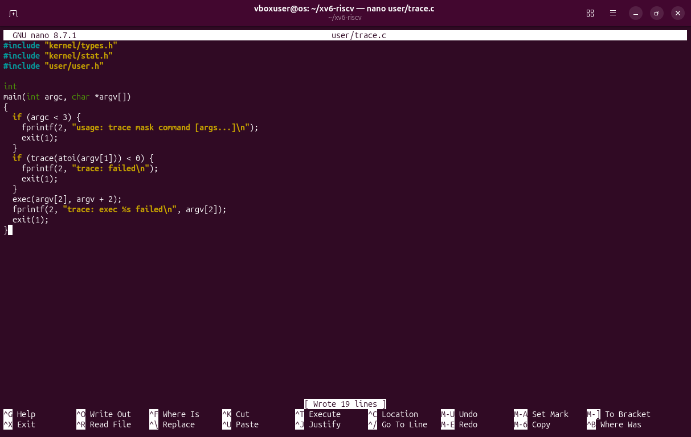

For `trace 32 grep hello README`: `argv[0]` = `trace`, `argv[1]` = `"32"`, `argv[2]` = `grep`, and so on. `atoi` turns `"32"` into the number 32. `trace(32)` sets the mask **on this process**. Then `exec(argv[2], argv + 2)` replaces the program of this process by `grep`, with the arguments `grep hello README`. The process stays the same (same pid, same `struct proc`), so the mask stays too: `grep` runs traced. The last two lines run only if `exec` fails.

### 1.5 Makefile: put trace on the xv6 disk

```bash
sed -i 's|^\t$U/_zombie\\$|&\n\t$U/_trace\\|' Makefile
grep -n -A2 '_zombie' Makefile | cat -A
git status -s
git diff --stat
```

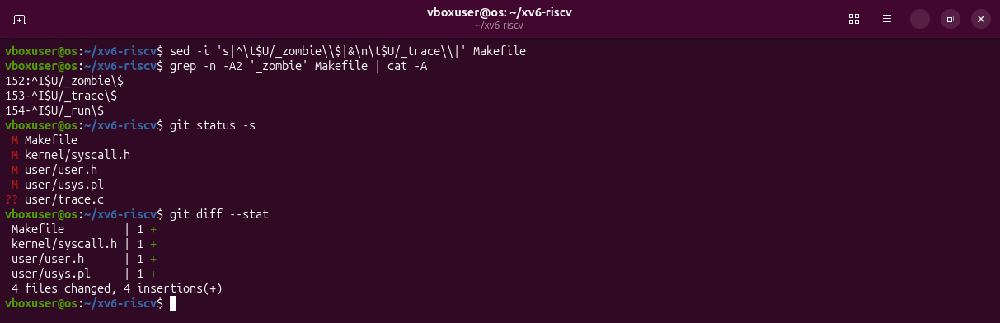

- `sed -i 's|A|B|' Makefile` replaces, inside the file, the line `A` by `B`. `A` is a TAB (`\t`), `$U/_zombie\` and the end of the line; `B` is `&` (the same line) + a new line + TAB + `$U/_trace\`.
- `cat -A` shows the invisible characters: `^I` is the TAB at the start, `$` is the end of the line, right after the backslash. A Makefile line that starts with spaces instead of a TAB, or has a space after `\`, breaks the build.
- Part 1 touched 4 files and created `user/trace.c`.

### Check 1

```bash
make qemu
$ trace 32 grep hello README
```

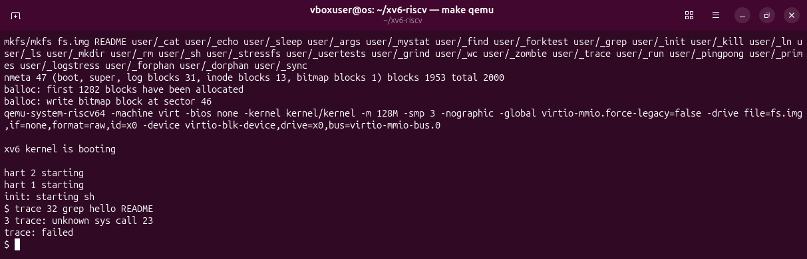

Exactly the output of the sheet:

- `mkfs/mkfs fs.img README user/_cat ... user/_trace ...`: `trace` is now on the xv6 disk.
- `3 trace: unknown sys call 23` is printed **by the kernel**, in `syscall()` (`kernel/syscall.c`): process 3, whose name is `trace`, did `ecall` with `a7 = 23`, and the table has no function at place 23. The kernel returns -1.
- `trace: failed` is printed by my program, because `trace(...)` returned -1.

The number reached the kernel; only the kernel side is missing.

```bash
grep -n -B1 -A4 'global trace' user/usys.S
git --no-pager diff kernel/syscall.h user/user.h user/usys.pl
```

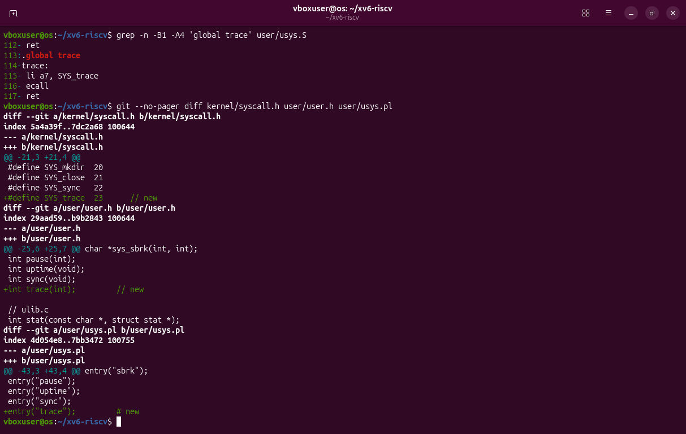

The generated stub is exactly the three instructions of the sheet: load 23 into `a7`, `ecall`, return. (`--no-pager` keeps `git diff` from opening a scrolling viewer.)

## Part 2 – The kernel side

### 2.1 kernel/proc.h: a place for the mask

```c
  char name[16];               // Process name (debugging)
  int trace_mask;              // new: which calls to print
```

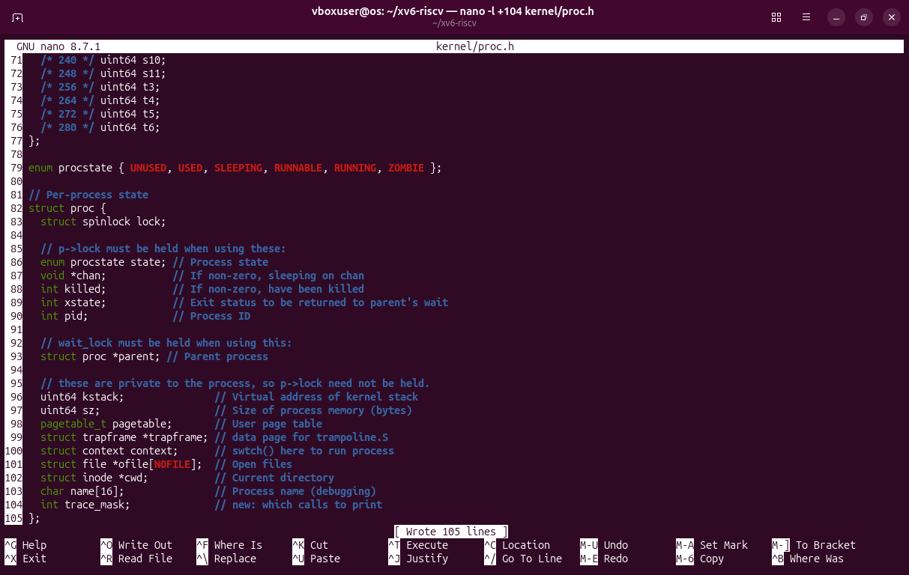

`struct proc` is the kernel's record of one process (its state, pid, memory, open files, name). One more field, so every process has its own mask. The process table is a global array, so at boot every field is 0: no process is traced.

### 2.2 kernel/sysproc.c: the handler

```c
uint64
sys_trace(void)
{
  int mask;
  argint(0, &mask);
  myproc()->trace_mask = mask;
  return 0;
}
```

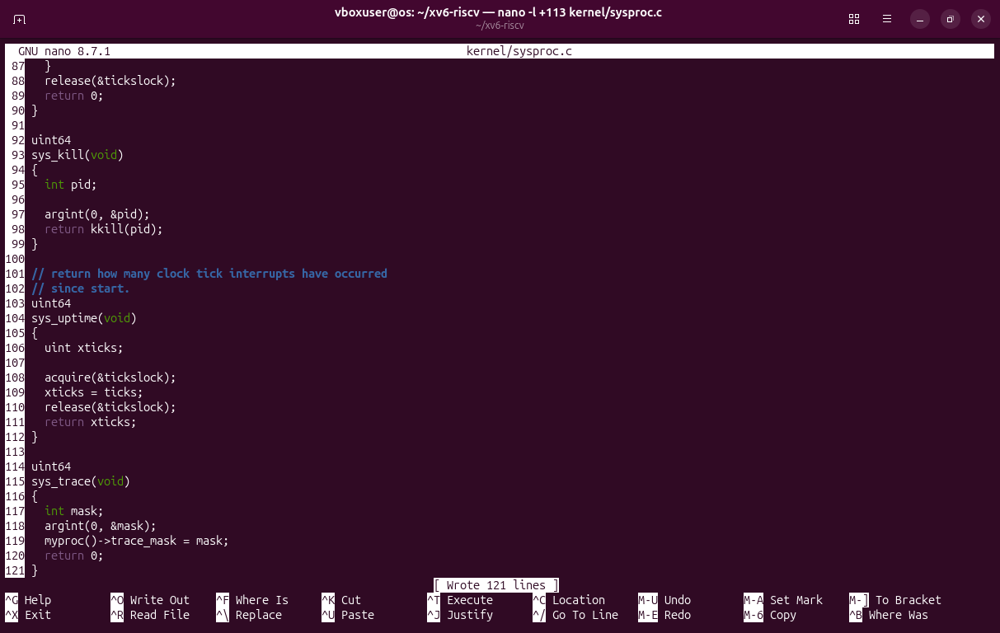

`argint(0, &mask)` reads argument 0, the value the user program had in register `a0` when it did `ecall` (the kernel saved all the user registers in the process's `trapframe`). `myproc()` is the process that is running now, the caller. The handler returns 0 = success.

### 2.3 kernel/syscall.c: the table

```c
extern uint64 sys_sync(void);
extern uint64 sys_trace(void);   // new
...
  [SYS_sync]    = sys_sync,
  [SYS_trace]   = sys_trace,       // new
```

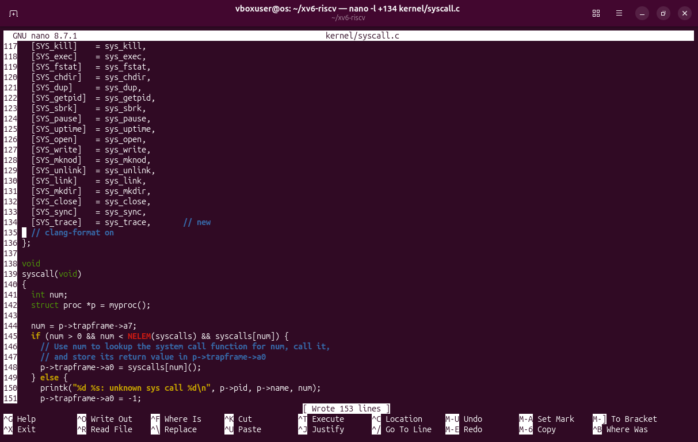

`extern` tells `syscall.c` that `sys_trace` exists in another file (`sysproc.c`). `syscalls[]` is an array of pointers to functions; `[SYS_trace] = sys_trace` puts `sys_trace` at index 23.

### 2.4 kernel/syscall.c: the names and the print

```c
static char *syscallnames[] = {
  [SYS_fork] "fork",   [SYS_exit] "exit",     [SYS_wait] "wait",
  ...
  [SYS_sync] "sync",   [SYS_trace] "trace",
};
```

and inside `syscall()`:

```c
    p->trapframe->a0 = syscalls[num]();
    if ((p->trace_mask >> num) & 1)                    // new
      printk("%d: syscall %s -> %ld\n",                // new
             p->pid, syscallnames[num], p->trapframe->a0);
```

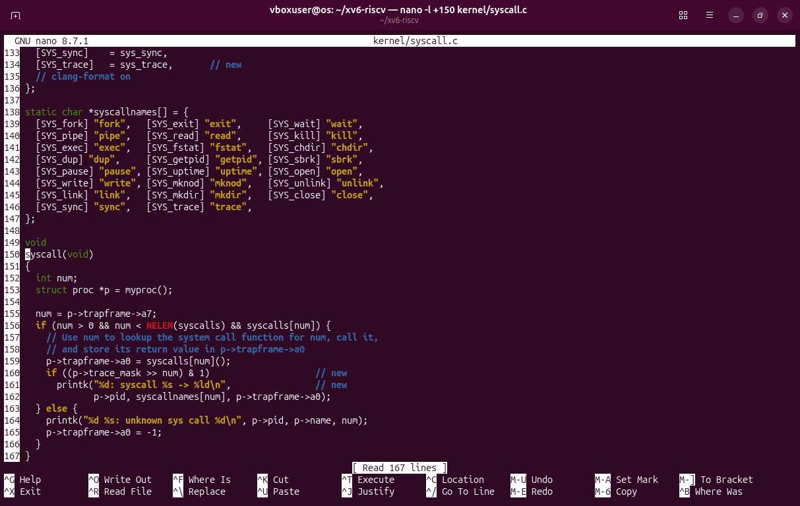

- The kernel knows calls only by number, so `syscallnames[5]` is `"read"` and so on. The table has to be **above** `syscall()`, because C must see a name before it is used.
- `syscalls[num]()` runs the call; its result goes into `p->trapframe->a0`, which becomes the user's return value. The print comes **after** that line, so `a0` already holds the result.
- `(p->trace_mask >> num) & 1`: shift the mask right by `num` places and keep the last bit: that is bit `num` of the mask. If it is 1, print pid, name and result.

A mistake I made and fixed here: I counted the lines of the names table wrong and typed the three print lines one line too low, right after `} else {`, where they would have run only for unknown calls. I saw it in nano before building, cut the three lines (Ctrl-K three times) and pasted them one line higher (Ctrl-U). Figure 2.4 shows the corrected file: lines 160-162, right after line 159.

### 2.5 kernel/proc.c: children inherit the mask

```c
  safestrcpy(np->name, p->name, sizeof(p->name));
  np->trace_mask = p->trace_mask;      // new
```

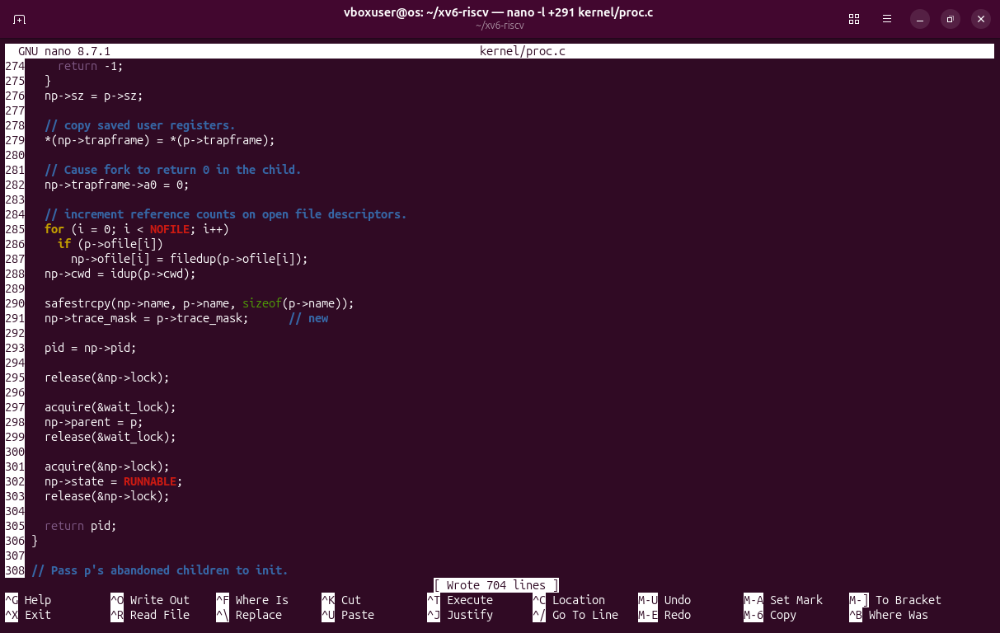

`kfork()` is the kernel side of `fork`: it makes `np` (new process) as a copy of `p` (the parent): memory, registers, open files, name. This line copies the mask as well.

```bash
git status -s
git --no-pager diff --stat
```

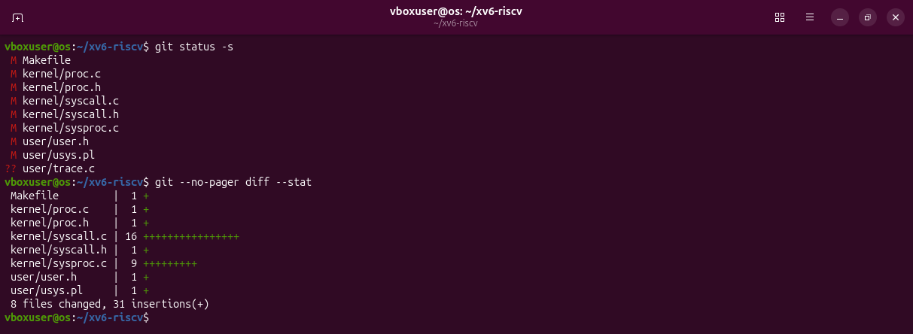

### Check 2

```bash
make qemu
$ trace 32 grep hello README
```

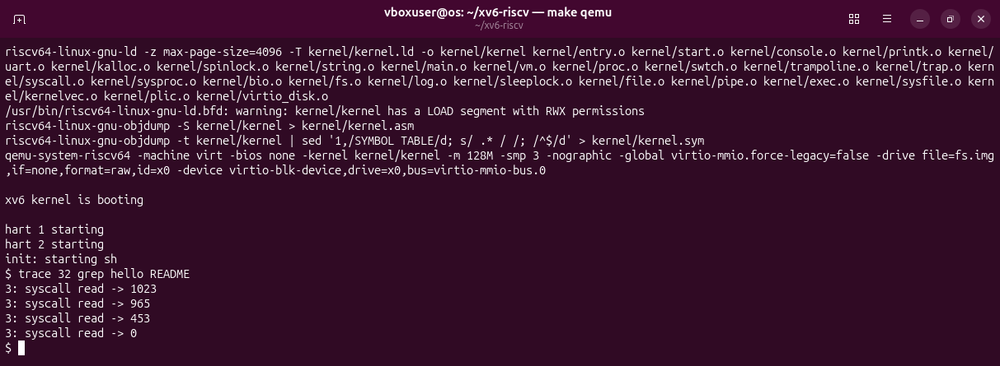

The kernel is rebuilt (most kernel files include `proc.h`, so they all compile again), and `trace` works: four reads of `grep`, with exactly the numbers of the sheet. `grep` reads into a buffer of 1024 bytes: the first read gets 1023; the last, unfinished line of the buffer is moved to the front, and the next read fills the rest (965); the third read gets what is left of the file (453); the fourth returns 0, the end of the file. 1023 + 965 + 453 = 2441, the size of `README`.

## Part 3 – Play with the mask

```bash
$ trace 2147483647 grep hello README
$ ls README
```

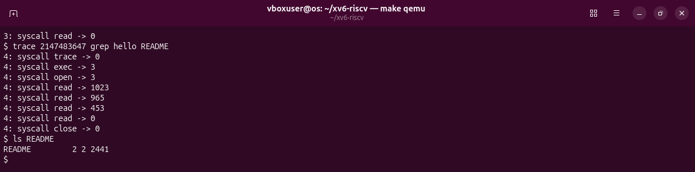

2147483647 = 2^31 - 1: bits 0 to 30 all on, so every call is printed. In order: `trace -> 0` (the call that set the mask is itself traced, because the print comes after it), `exec -> 3` (xv6's `exec` returns `argc`, 3 arguments), `open -> 3` (README is descriptor 3), the four reads, `close -> 0`. The output matches the sheet line for line, pid 4 included. The xv6 `ls README` prints name, type (2 = file), inode number and size: 2441.

```bash
$ trace 2 usertests forkforkfork
```

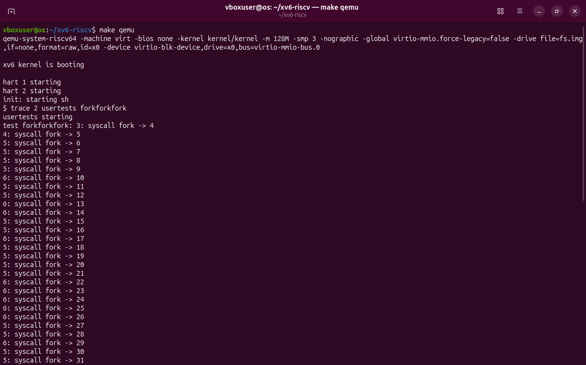

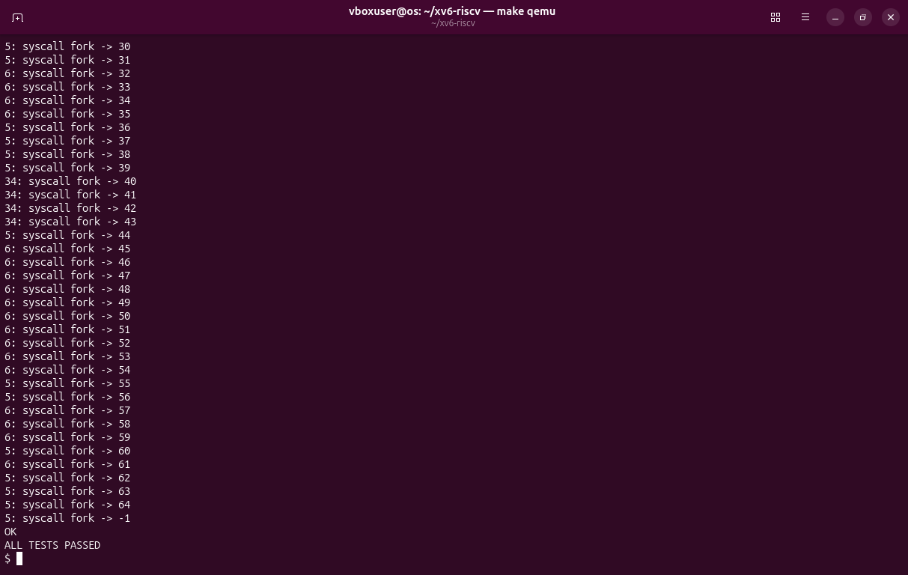

Mask 2 = 2^1: only `fork` (number 1). `forkforkfork` is a test of `usertests`: a child forks in a loop, and every new child does the same, until the process table is full (xv6 has room for 64 processes) and `fork` returns -1; then they all stop. Lines come from pids 3 (`usertests` starting the test), 4 (the test), and then 5, 6 and 34, the processes that kept forking. This test was the one I was worried about: `usertests` froze this VM once before, so I committed the work just before running it (Figure 3.6). It passed: `ALL TESTS PASSED`.

```bash
$ trace 65536 echo hi
```

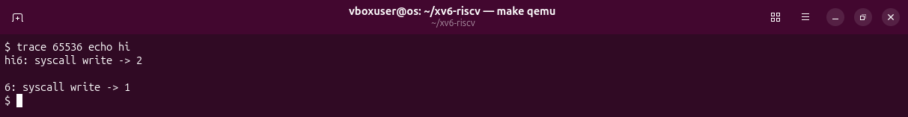

65536 = 2^16, and 16 is `write`. The screen shows `hi6: syscall write -> 2`, an empty line, then `6: syscall write -> 1`. `echo` calls `write` twice: once for `hi` (2 bytes), once for the new line (1 byte). The kernel prints its trace line after each `write`, so the first trace line sticks to `hi`, then echo's own `\n` makes the empty line.

```bash
$ trace 2129920 grep hello README
```

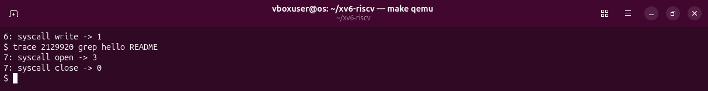

Question 4 of the sheet asks for the mask of `open` (15) and `close` (21) together: 2^15 + 2^21 = 32768 + 2097152 = 2129920. I tried it: only `open -> 3` and `close -> 0` are printed.

```bash
git add Makefile kernel user
git commit -q -m "Lab 10: trace system call"
git --no-pager log --oneline -3
git --no-pager show --stat --format='%h %an <%ae>%n%ad%n%n    %s%n' HEAD
```

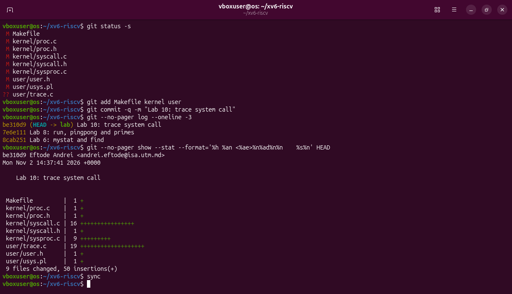

### Answers

1. **In `trace 32 grep hello README` why do you see only read, and not open or close?** 32 = 2^5 has only bit 5 on, and 5 is `SYS_read`. The kernel prints a call only when `(p->trace_mask >> num) & 1` is 1, and bits 15 (`open`) and 21 (`close`) are 0. Both calls still happen: with all bits on they are printed (Figure 3.1).
2. **In forkforkfork, several different pids print lines. Which line of code from Part 2 makes that possible?** `np->trace_mask = p->trace_mask;` in `kfork()` (2.5). Each child gets a copy of its parent's mask, so the forks done by the children and grandchildren are traced too. Without it a new process would start with mask 0, and only the process that called `trace` would print.
3. **In `trace 65536 echo hi` the trace line is printed between "hi" and the new line. Why? How many times does echo call write?** Twice: `write(1, "hi", 2)` and then `write(1, "\n", 1)`. The kernel prints its line right after each `write` returns: after `hi` is on the screen and before `echo` writes the new line.
4. **Which mask traces both open (15) and close (21), and nothing else?** 2^15 + 2^21 = **2129920** (Figure 3.5).

## Optional – sysinfo

The sheet's recipe: number 24, stub, table, handler, plus one helper in `kernel/kalloc.c` and one in `kernel/proc.c`. The call fills a structure in the caller's memory.

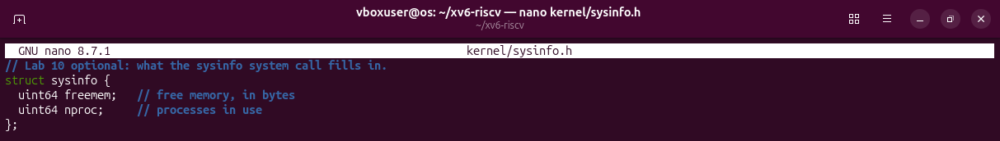

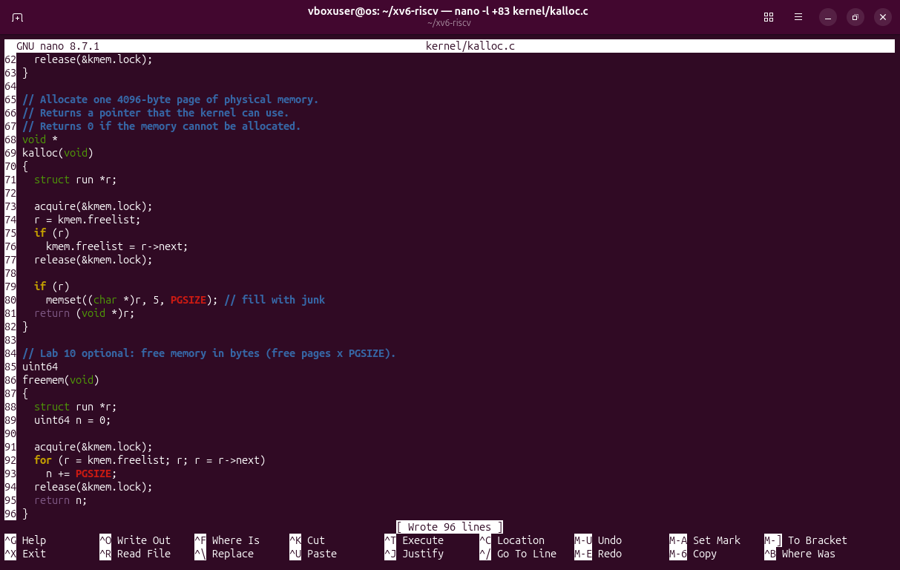

xv6 keeps free memory as a linked list of free 4096-byte pages (`kmem.freelist`). `freemem()` walks the list and adds 4096 per page. It holds `kmem.lock` while walking, so another CPU cannot take or give back a page in the middle.

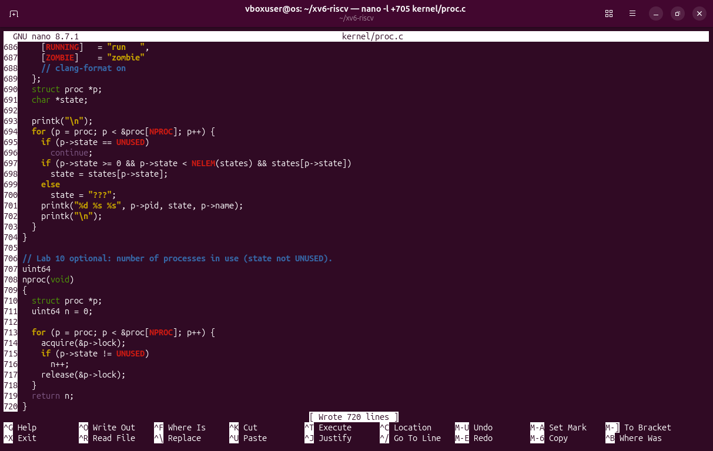

`proc[]` has 64 slots; a slot whose state is `UNUSED` is free. `nproc()` counts the others, each under the lock of its slot.

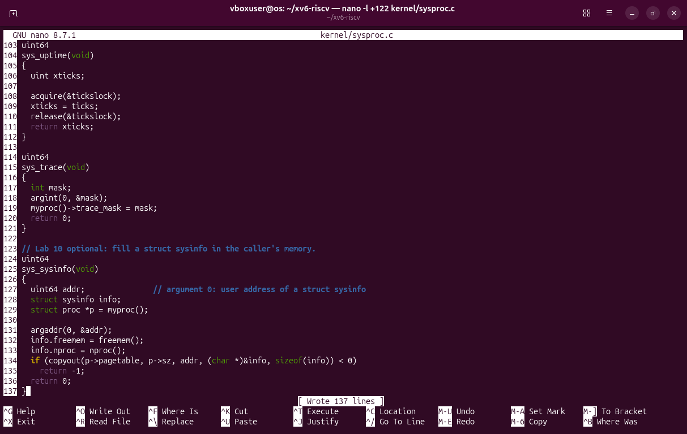

The user passes a **pointer** to its own `struct sysinfo`. That address belongs to the user's memory, not the kernel's, so the kernel cannot simply write to it: `copyout(p->pagetable, p->sz, addr, ...)` looks the address up in the process's page table, checks it, and copies the bytes there. If the address is not valid, `copyout` returns -1 and so does the call.

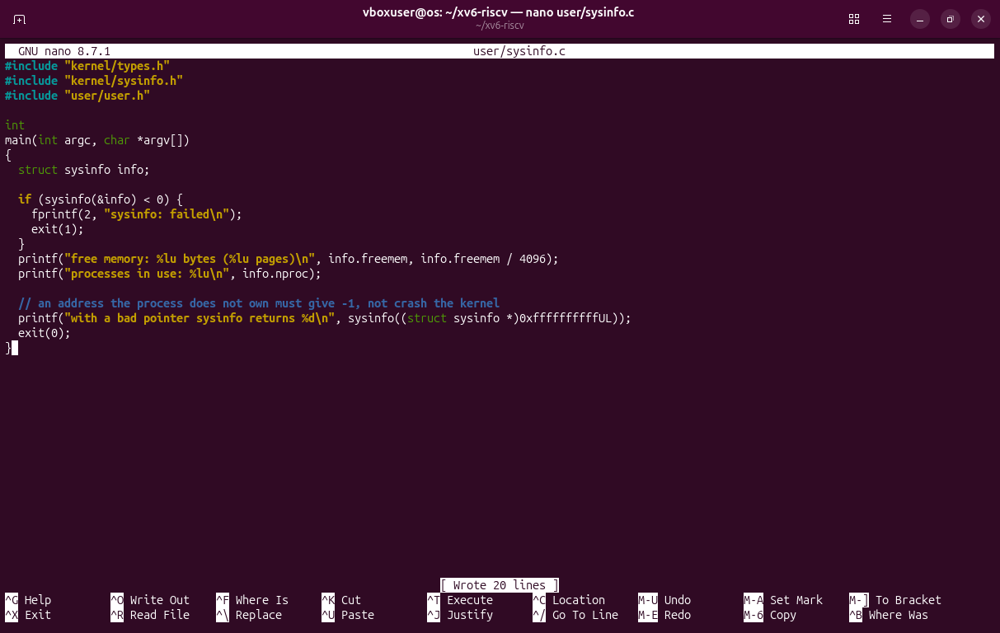

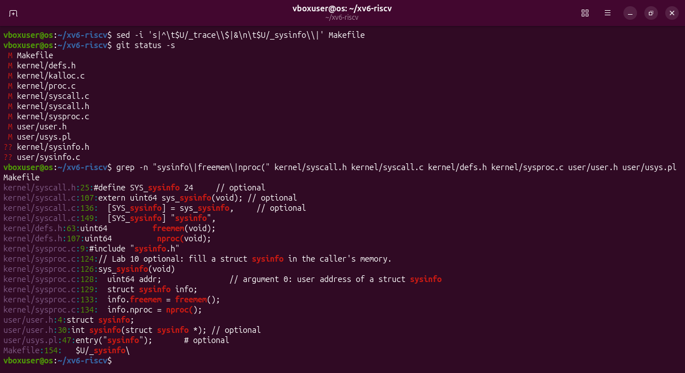

`defs.h` declares `freemem()` and `nproc()` for the other kernel files. `user.h` needs `struct sysinfo;` before the declaration `int sysinfo(struct sysinfo *);`.

```bash
make qemu
$ sysinfo
$ sleep 300 &
$ sysinfo
$ trace 16777216 sysinfo
```

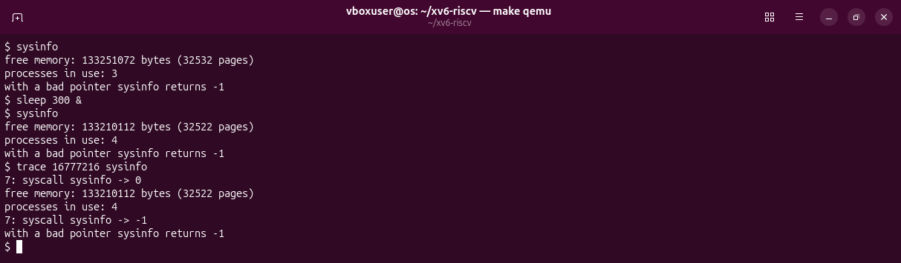

- 3 processes: `init`, the shell `sh`, and `sysinfo` itself.
- With `sleep 300 &` running in the background: 4 processes, and 10 free pages (40960 bytes) less, the memory of the sleeping process (its code and data, its stack, its trapframe and its page table).
- The bad pointer `0xffffffffff` is above the highest address a process can have, so `copyout` refuses and `sysinfo` returns -1. The kernel does not crash.
- 16777216 = 2^24: the trace shows `sysinfo -> 0` for the good call and `sysinfo -> -1` for the bad one.

## Deliverables

```bash
make clean > /dev/null; ls kernel/kernel fs.img
make qemu
$ trace 32 grep hello README
$ sysinfo
```

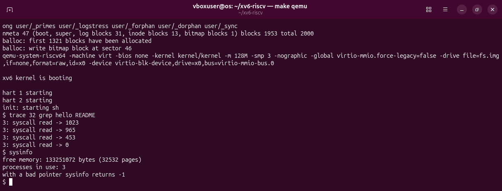

From a clean tree, everything builds without a warning and both new system calls work.

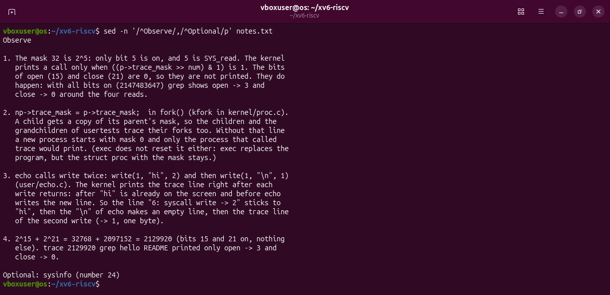

`notes.txt` holds the answers, as the sheet asks. I wrote it on Windows and copied it into the VM with `wget`.

```bash
git add notes.txt
git commit -q -m "Lab 10: notes.txt"
git --no-pager log --oneline -5
git --no-pager diff --stat 7e6e111 HEAD
git status
```

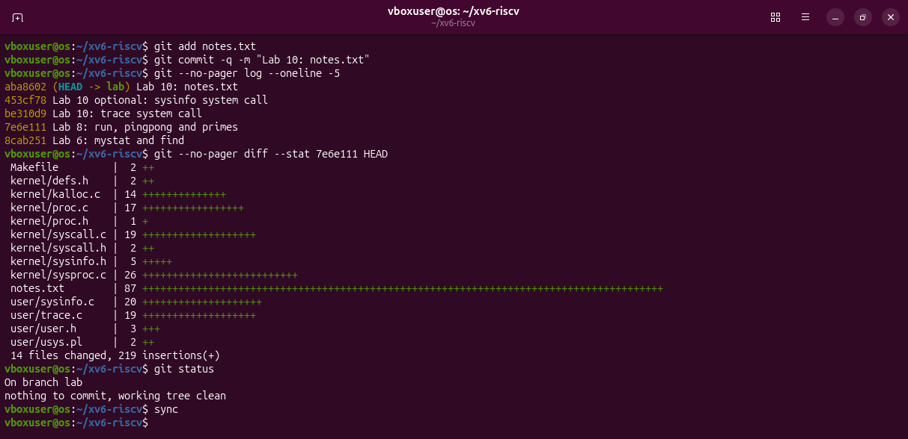

"Your modified xv6 tree (committed to git), with trace working": three commits on branch `lab`, on top of Lab 8 (`7e6e111`): the `trace` call, the optional `sysinfo` call, and `notes.txt`. `git status` is clean. The files in this folder are byte-for-byte copies of the ones in the VM, and `lab10.patch` holds the three commits.

## What I learned

- A system call is only a number. The user stub puts it in `a7` and runs `ecall`; the kernel saves the user registers, reads `a7`, calls the function at that place in its table, and puts the result in `a0`. Adding a system call means filling every step of that path: number, declaration, stub, table entry, handler.
- The kernel cannot trust or directly use user pointers; data goes in and out of user memory through `copyin`/`copyout`, which check the address.
- A field in `struct proc` lives as long as the process: `exec` keeps it, and `fork` copies it only if the code says so. That one line decides whether a whole family of processes is traced.
- `echo` calls `write` directly, with no library buffer in between, so each `write` reaches the console at once and the trace line appears exactly between the two.
- `trace` is a small `strace` built from inside. In Lab 9 `strace` watched the same door from outside.
