# Lab 11 – The Race and the Semaphore

Course: Operating Systems, FCIM / FAF, UTM, 2026-2027. Track A: the real OS, from the outside (Linux).

This page explains everything that was done in the lab, step by step: every command, what it printed, and why. The figure numbers are the same as in the Word report, so the two can be read side by side.

## What is in this folder

| File | What it is |
|---|---|
| `Lab11_EftodeAndrei_FAF-242.docx` | The report: title page, 22 screenshots, the answers to every Observe box |
| `race.c` | Two threads add to one counter with no protection |
| `mutex.c` | The same counter, protected by a mutex |
| `sem.c` | The same counter, protected by a semaphore that starts at 1 |
| `order.c` | A semaphore that starts at 0, used as a signal |
| `parking.c` | A semaphore that starts at 3, used as a counter |
| `atomic.c` | The optional part: a counter with no lock at all |
| `report.md` | The answers the sheet asks to write "in report.md" |
| `full_explanations.md` | The slow version of this page: every line of code, worked examples, a self-test |
| `screenshots/` | The terminal screenshots (`fig-1-1.png` is Figure 1.1, and so on) |

## How to run it

```bash
mkdir -p ~/os-lab11 && cd ~/os-lab11     # put the .c files here
gcc -Wall -pthread -o race race.c   && ./race
gcc -Wall -pthread -o mutex mutex.c && ./mutex
gcc -Wall -pthread -o sem sem.c     && ./sem
gcc -Wall -pthread -o order order.c && ./order
gcc -Wall -pthread -o parking parking.c && ./parking
gcc -Wall -pthread -o atomic atomic.c   && time ./atomic
```

Do not add `-O2`. The optimizer would turn the loop of `race.c` into one addition and hide the race.

## Words used on this page

- **Thread**: one line of execution inside a program. Threads of one program share the same memory.
- **Race condition**: the result depends on who runs first. Here, two threads change one variable at the same time.
- **Critical section**: the piece of code that only one thread may run at a time.
- **Mutex**: a lock. `pthread_mutex_lock` takes it (or waits), `pthread_mutex_unlock` gives it back.
- **Semaphore**: a number that never goes below 0. `sem_wait` takes one unit, and waits if there is none. `sem_post` gives one back.
- **`-pthread`**: tells `gcc` to build with the threads library.

## Before the lab

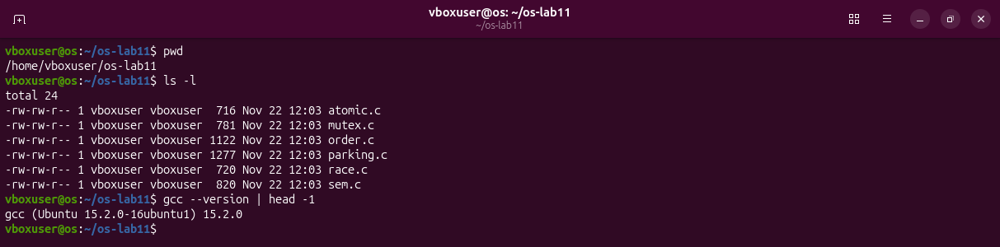

## Part 1 – See the race

`race.c` starts two threads. Each adds 1 to the same `counter`, one million times. The right answer is 2 000 000.

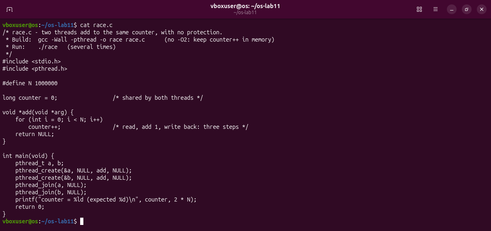

```bash
gcc -Wall -pthread -o race race.c
./race
./race
./race
```

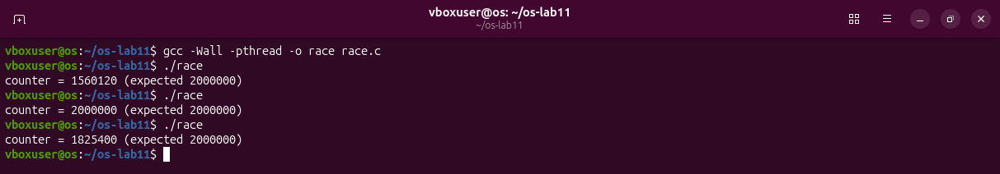

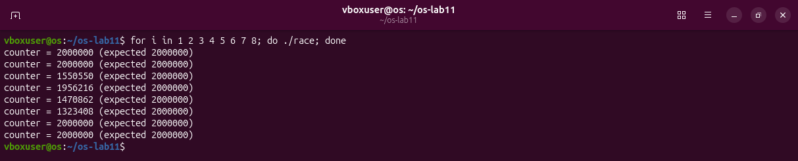

**One thing differs from the sheet.** The sheet says the result is never 2 000 000. On this VM it sometimes is. One million additions take only a few milliseconds, so one thread can finish before the other really starts. To check this, I counted the right answers in 100 runs, then made the loop 100 times longer:

```bash
for i in $(seq 100); do ./race; done | grep -c "= 2000000 "
sed 's/define N 1000000/define N 100000000/' race.c > race_long.c
gcc -Wall -pthread -o race_long race_long.c
for i in 1 2 3 4 5 6; do ./race_long; done
```

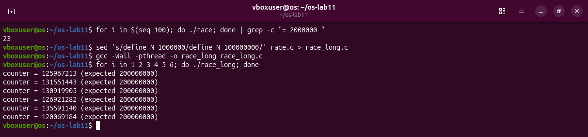

**Observe.**

1. `counter++` is three steps: load the value into a register, add 1, store it back.
2. The counter is 5. A loads 5, B loads 5, A stores 6, B stores 6. Two additions ran, the counter grew by 1.
3. The scheduler decides when each thread runs and on which CPU, and that timing differs at every run.

## Part 2 – Fix it: mutex, then semaphore

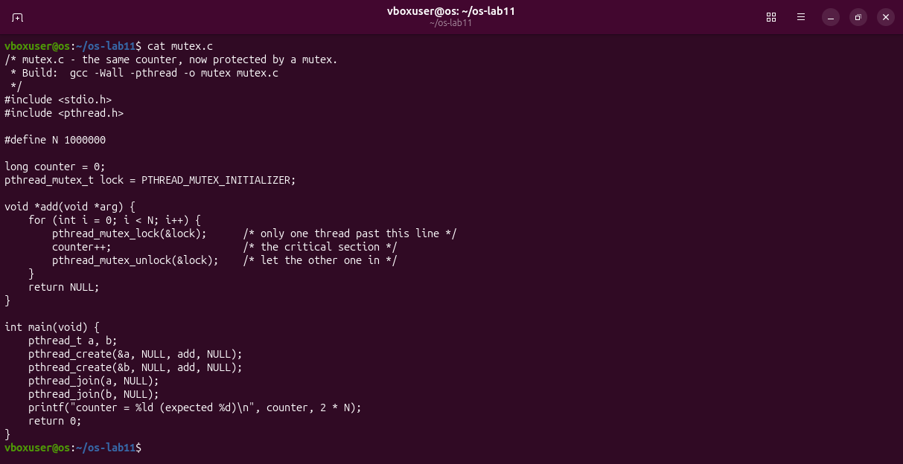


A semaphore that starts at 1 does the same job. The first `sem_wait` turns 1 into 0 and goes in. The other thread finds 0 and waits.

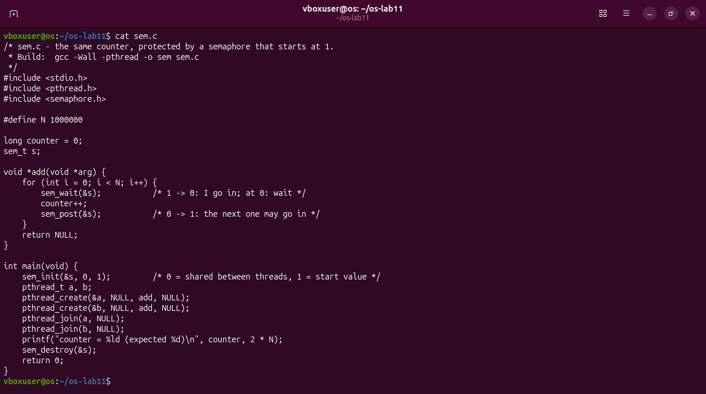

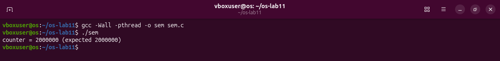

`time` prints how long a command took. `real` is the clock on the wall, `user` is CPU time in the program, `sys` is CPU time in the kernel.

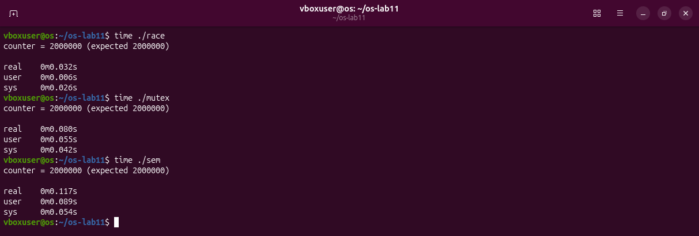

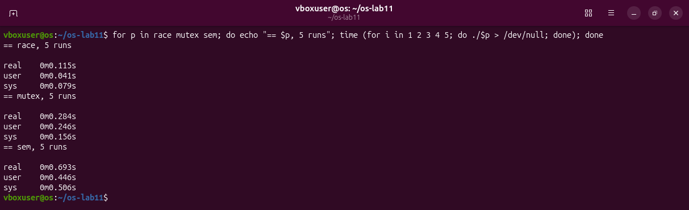

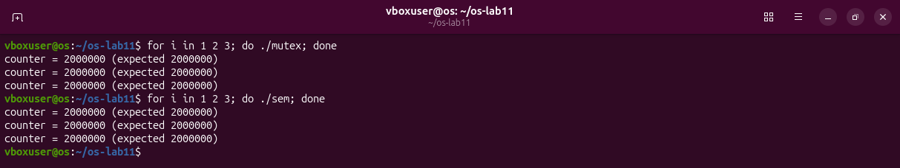

For Observe 2, `sed` makes a copy of `sem.c` with start value 2:

```bash
sed 's/sem_init(&s, 0, 1)/sem_init(\&s, 0, 2)/' sem.c > sem2.c
```

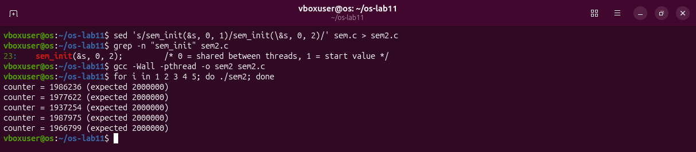

**Observe.**

1. Yes, the answer is always 2 000 000.
2. With start value 2, both threads can be inside at once, so nothing is protected.
3. Every addition also pays for a lock and an unlock, and a thread that finds the lock taken waits through the kernel.

## Part 3 – A semaphore as a signal

Now the problem is the **order**: B must read the message only after A has written it. A semaphore that starts at 0 is a closed door.

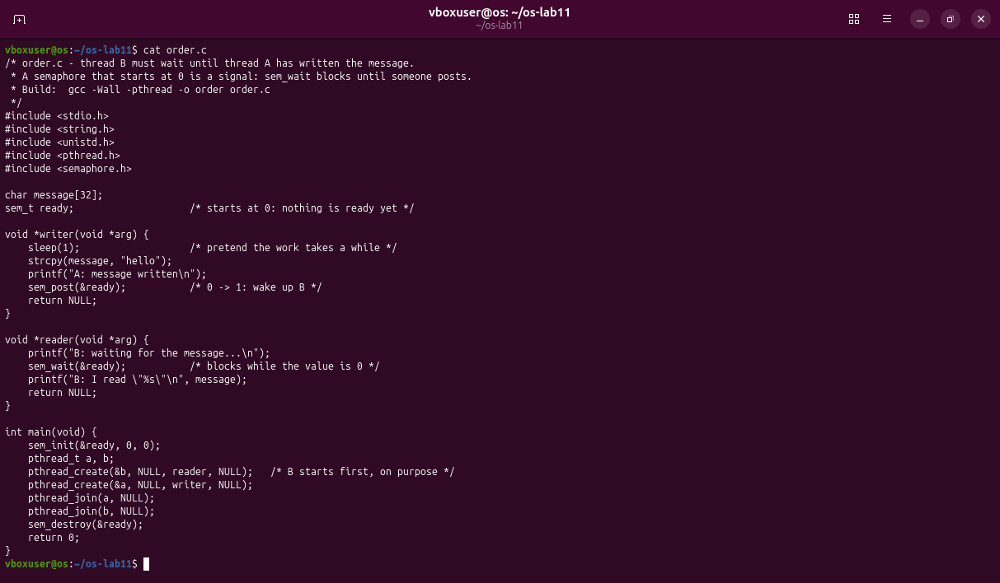

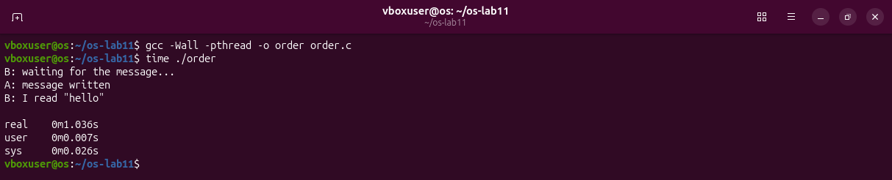

With start value 1 the door is already open:

```bash
sed 's/sem_init(&ready, 0, 0)/sem_init(\&ready, 0, 1)/' order.c > order1.c
```

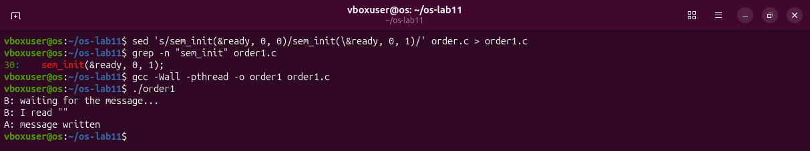

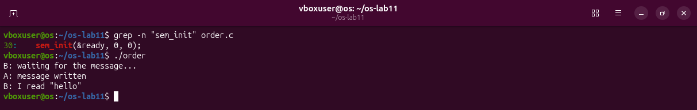

**Observe.**

1. B reads `""`. The semaphore already has one unit, so B passes before A has written anything.
2. A semaphore that starts at 0 means "it has not happened yet": `sem_wait` waits for someone's `sem_post`.

## Part 4 – A semaphore as a counter: the parking lot

Six cars, three places. The semaphore starts at 3 and counts the free places.

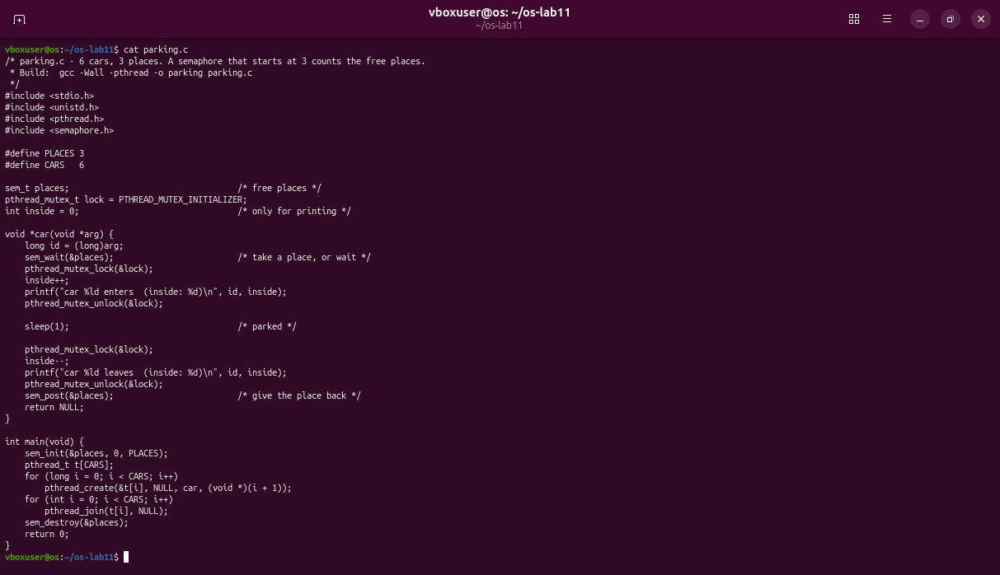

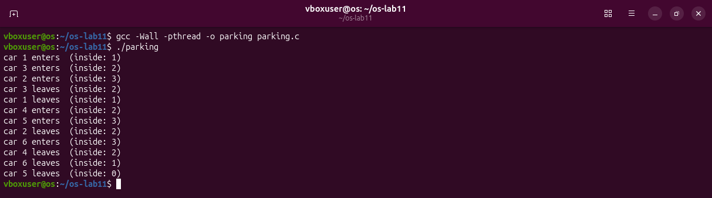

To check many runs at once, `grep -o` keeps only the text "inside: N", and `sort | uniq -c` counts each value:

```bash
for i in 1 2 3 4 5; do ./parking; done | grep -o "inside: [0-9]" | sort | uniq -c
```

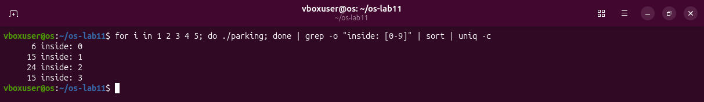

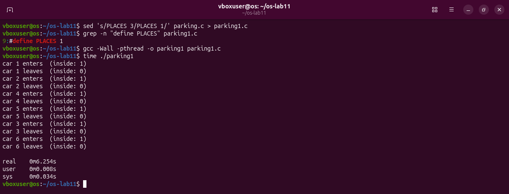

**Observe.**

1. The largest value is 3. `sem_wait(&places)` guarantees it: the semaphore starts at 3, so the fourth car waits.
2. With one place the semaphore becomes a lock (a mutex).

## Optional – no lock at all

`atomic_fetch_add` does load, add and store as one indivisible step of the CPU, so no thread can cut in.

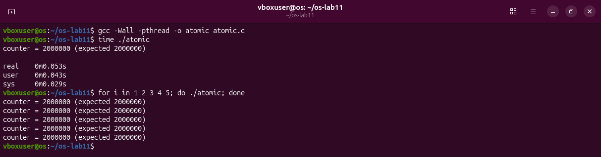

## Conclusions

A line as small as `counter++` is not safe when two threads share it, and the bug is hard to see because the program is sometimes right by luck. The same semaphore does three jobs, decided only by its start value: 1 is a lock, 0 is a signal, N counts N free places.
