# Lab 12 – Producer, Consumer and the Other Tools

Course: Operating Systems, FCIM / FAF, UTM, 2026-2027. Track A: the real OS, from the outside (Linux).

This page explains everything that was done in the lab, step by step: every command, what it printed, and why. The figure numbers are the same as in the Word report, so the two can be read side by side.

## What is in this folder

| File | What it is |
|---|---|
| `Lab12_EftodeAndrei_FAF-242.docx` | The report: title page, 22 screenshots, the answers to every Observe box |
| `prodcons.c` | Producer and consumer around a buffer of 4 slots |
| `condvar.c` | The order problem of Lab 11, solved with a condition variable |
| `readers.c` | Readers and writers with two semaphores |
| `deadlock.c` | Two threads and two mutexes, **the fixed version** (the original is in the git history) |
| `report.md` | The answers the sheet asks to write "in report.md" |
| `full_explanations.md` | The slow version of this page: every line of code, worked examples, a self-test |
| `screenshots/` | The terminal screenshots (`fig-1-1.png` is Figure 1.1, and so on) |

## How to run it

```bash
mkdir -p ~/os-lab12 && cd ~/os-lab12     # put the .c files here
gcc -Wall -pthread -o prodcons prodcons.c && ./prodcons
gcc -Wall -pthread -o condvar condvar.c   && ./condvar
gcc -Wall -pthread -o readers readers.c   && ./readers
gcc -Wall -pthread -o deadlock deadlock.c
timeout 15 ./deadlock; echo "exit code: $?"
```

## Words used on this page

- **Buffer**: a small piece of memory where items wait between the one who makes them and the one who uses them.
- **Condition variable**: a place where a thread sleeps until another thread says "something changed".
- **Deadlock**: threads wait for each other in a circle, so none of them can ever continue.
- **Starvation**: a thread could run, but others always go first, so it waits forever.
- **Exit code**: the number a program returns when it ends. `$?` holds the last one. 0 means success, and `timeout` returns 124 when it had to kill the program.

## Before the lab

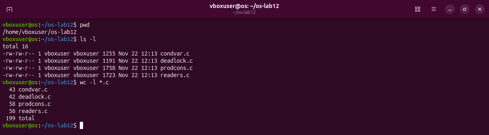

## Part 1 – Producer and consumer

A fast producer puts 8 items into a buffer of 4 slots, and a slow consumer takes them out. Three tools work together: `empty` counts the free slots (starts at 4), `full` counts the filled slots (starts at 0), and a mutex protects the buffer itself.

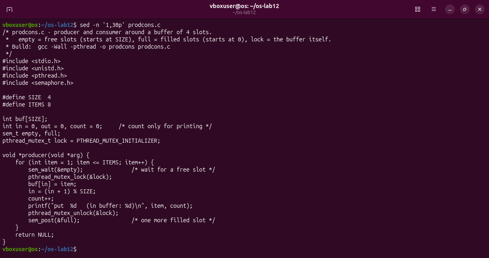

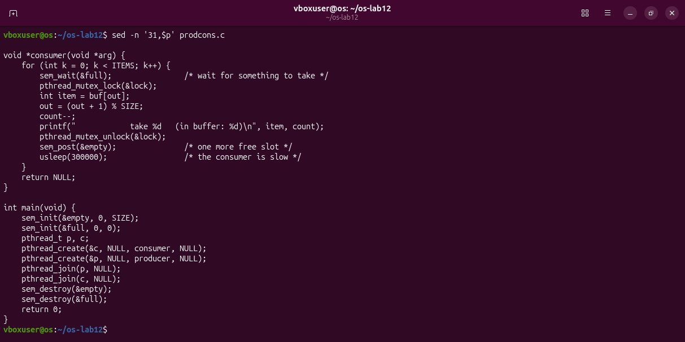

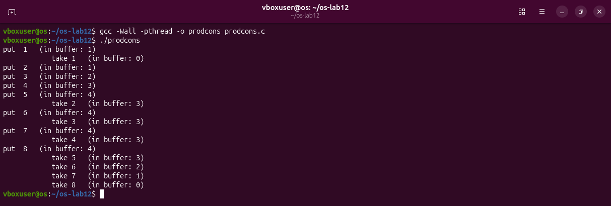

The order of the lines is not exactly the one on the sheet, because the scheduler decides who runs first. The rule still holds: never more than 4 items in the buffer.

For Observe 3, this `sed` swaps the two first lines of the producer, in a copy of the file:

```bash
sed '/sem_wait(&empty)/{N;s/\(.*\)\n\(.*\)/\2\n\1/}' prodcons.c > prodcons_bad.c
```

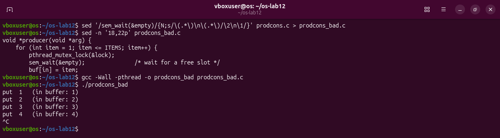

**Observe.**

1. `sem_wait(&empty)` stops the producer when no slot is free.
2. The consumer waits at the start, in `sem_wait(&full)`, because `full` starts at 0.
3. The producer sleeps in `sem_wait(&empty)` while holding the mutex. The consumer needs that mutex to take an item, and only the consumer can post `empty`. Each waits for the other forever.

## Part 2 – The condition variable

The state is a normal variable, `ready`, protected by a mutex. The condition variable is only the place where B sleeps.

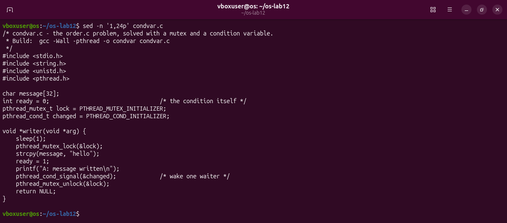

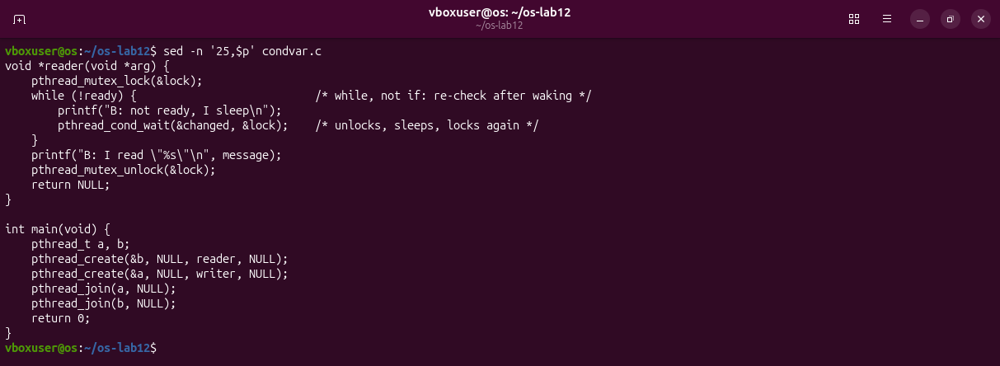

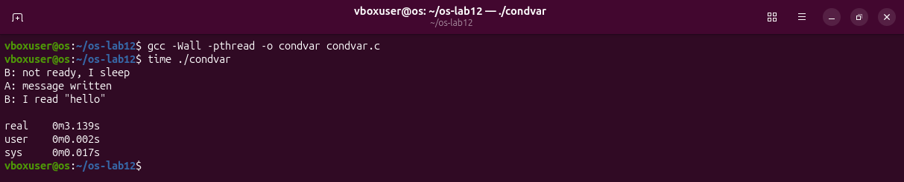

The `sleep(1)` took more than one second here. `sleep` promises **at least** that long, and this VM is sometimes slow to wake up. Four more runs:

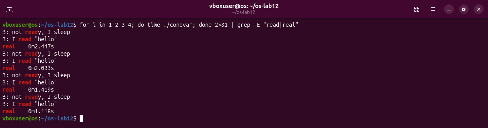

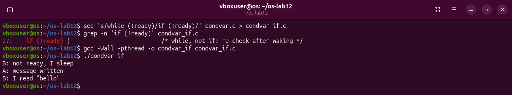

**Observe.**

1. The variable `ready` remembers it. The condition variable is only the place where B sleeps.
2. Yes, because there is one writer and one reader, and B was woken only after `ready = 1`.
3. `pthread_cond_wait` may return with no signal (a spurious wakeup), and with several readers another thread can run first and change `ready` back. So the condition must be tested again.

## Part 3 – Readers and writers

Many readers may read together, but a writer must be alone. `room` is 1 when the room is free, and `rlock` protects the counter `readers`. The first reader in locks the room, and the last one out unlocks it.

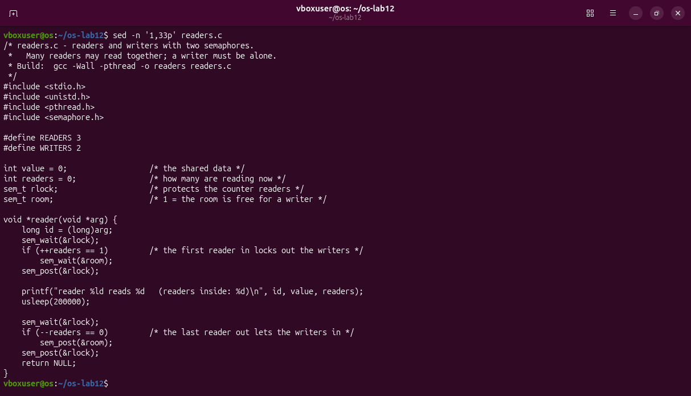

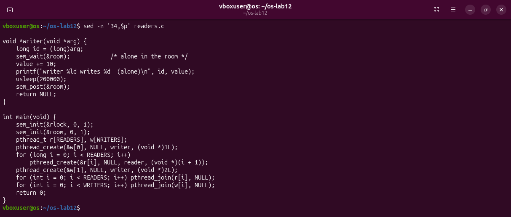

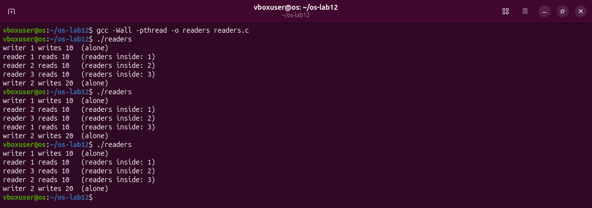

**Observe.**

1. `if (++readers == 1) sem_wait(&room);` and `if (--readers == 0) sem_post(&room);`.
2. `++readers` is three steps. Without `rlock`, two readers could both see 0 and both wait for the room, or an update could be lost and the count would never return to 0.
3. Writer 2 can wait forever: while one reader is inside, new readers walk in and `room` is never given back. This is starvation.

## Part 4 – Build a deadlock, then remove it

Two threads, two mutexes, taken in opposite order.

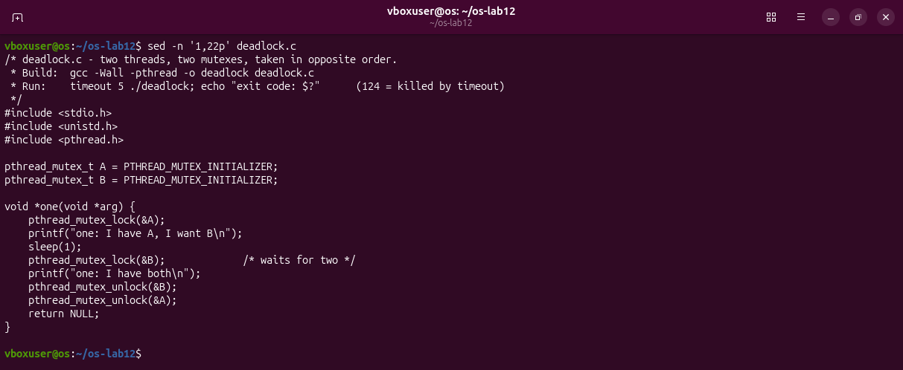

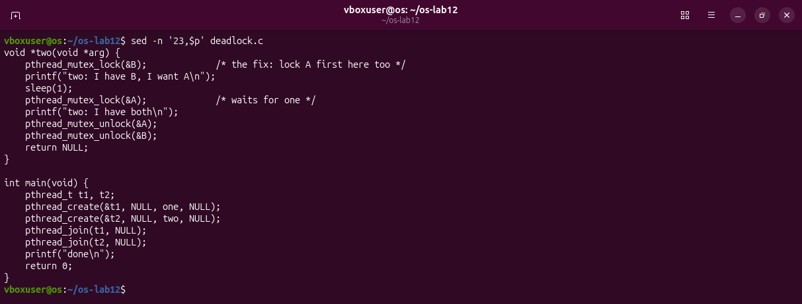

```bash
timeout 5 ./deadlock; echo "exit code: $?"
```

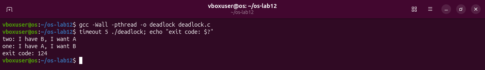

For Observe 2, `grep -v` copies the file without the two `sleep(1)` lines. The loops run it many times and count the exit codes:

```bash
grep -v "sleep(1)" deadlock_orig.c > nosleep.c
for i in $(seq 10); do timeout 1 ./nosleep > /dev/null; echo -n "$? "; done; echo
for i in $(seq 200); do timeout 0.3 ./nosleep > /dev/null; echo $?; done | sort | uniq -c
```

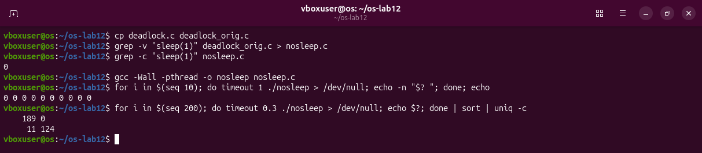

The fix: thread two also takes A first.

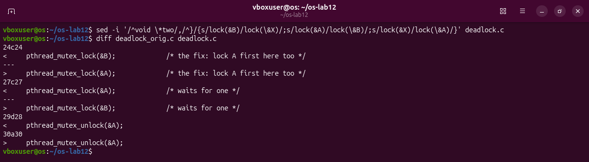

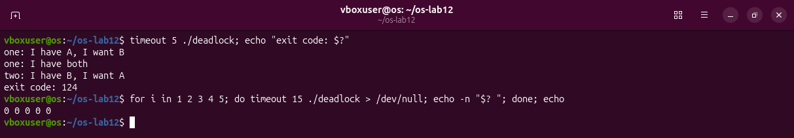

**Why a fixed program got exit code 124 once.** It was not a deadlock. The program needs two `sleep(1)`, and in this VM one `sleep(1)` really takes 1.0 to 2.6 s (Figure 4.7). So the whole program needs 2.0 to 6.2 s, and that run went over the 5 seconds of `timeout`. With a longer timeout, it ended with 0 in 10 runs out of 10 (Figure 4.8).


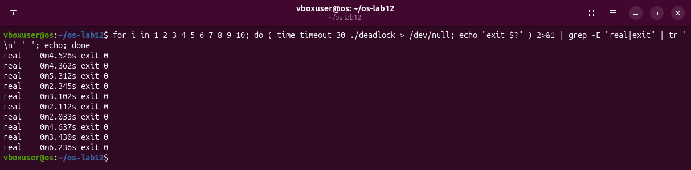

**Observe.**

1. Thread one holds A and waits for B. Thread two holds B and waits for A. The circle: one → B → two → A → one.
2. No, most runs finish. That is worse: the bug passes the tests and appears only sometimes.
3. If everyone takes A before B, nobody can hold B while waiting for A, so the circle cannot close.

## Conclusions

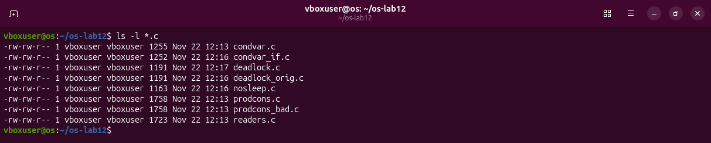

Semaphores count, a mutex protects, and a condition variable is a place to sleep. The order of the calls matters as much as the calls: one swapped line in the producer hung the program. A deadlock needs a circle of waiting, so one global lock order removes it.
