# Lab 13 – Semaphores in Your Own Kernel

Course: Operating Systems, FCIM / FAF, UTM, 2026-2027. Track B: build your own small OS (xv6).

This page explains everything that was done in the lab, step by step: every change, what it printed, and why. The figure numbers are the same as in the Word report, so the two can be read side by side.

## What is in this folder

| File | What it is |
|---|---|
| `Lab13_EftodeAndrei_FAF-242.docx` | The report: title page, 26 screenshots, the answers to every Observe box |
| `kernel/sem.c` | The new kernel file: the semaphores and their system calls |
| `kernel/syscall.h`, `kernel/syscall.c` | The numbers and the table of system calls |
| `user/user.h`, `user/usys.pl` | The user side of the calls |
| `user/semtest.c`, `user/mix.c` | The two test programs of the sheet |
| `user/semtry.c` | The optional part: shows both answers of `sem_trydown` |
| `Makefile` | Builds `sem.o` into the kernel and puts the programs on the disk |
| `lab13.patch` | The 14 commits of this lab as one file |
| `notes.txt` | The answers the sheet asks to write "in notes.txt" |
| `full_explanations.md` | The slow version of this page: every line of `sem.c`, worked examples, a self-test |
| `screenshots/` | The terminal screenshots (`fig-1-1.png` is Figure 1.1, and so on) |

The other files in `kernel/` and `user/` come from Labs 4, 6, 8 and 10. They are here because the Makefile also builds them.

## How to run it

```bash
git clone https://github.com/mit-pdos/xv6-riscv && cd xv6-riscv
git checkout 06aad25
cp -r ../lab13/kernel ../lab13/user ../lab13/Makefile .
make qemu
# inside xv6:
semtest
mix
mix lock
semtry
# leave QEMU with Ctrl-A, then x
```

## Words used on this page

- **System call**: a request from a user program to the kernel. Each one has a number.
- **Spinlock**: a kernel lock. A CPU that wants it keeps trying in a loop until it is free.
- **`sleep` / `wakeup`**: how a process waits in the kernel without using the CPU, and how another one wakes it.
- **Channel**: the address a process sleeps on. Here it is the address of the semaphore.
- **Panic**: the kernel found something impossible and stops.

## Before the lab

The sheet demands the numbers 24, 25 and 26. My optional `sysinfo` from Lab 10 already had 24, so the first commit moves it to 28. The `lab10/` folder is not changed.

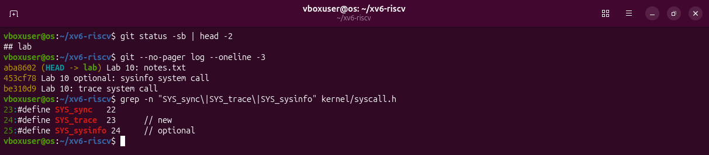

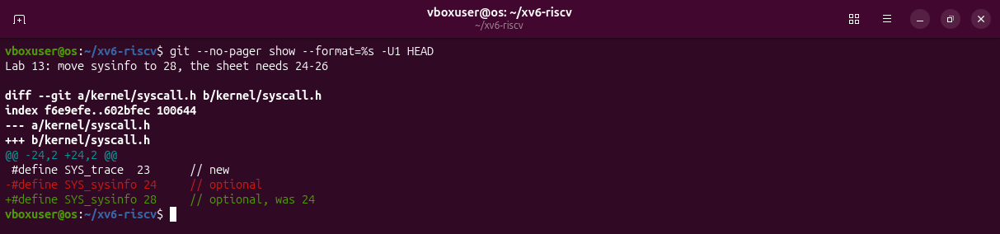

## Part 1 – The numbers and the user side

The same recipe as `trace` in Lab 10, three times: a number in `kernel/syscall.h`, a declaration in `user/user.h`, a stub in `user/usys.pl`.

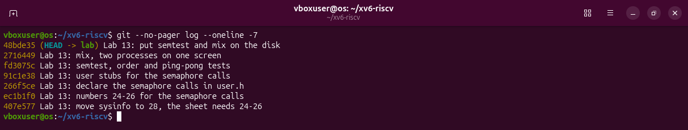

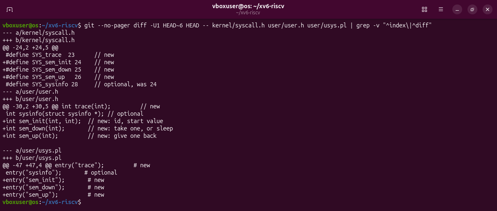

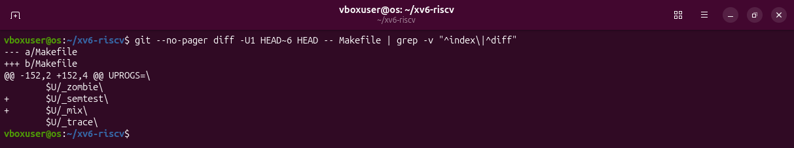

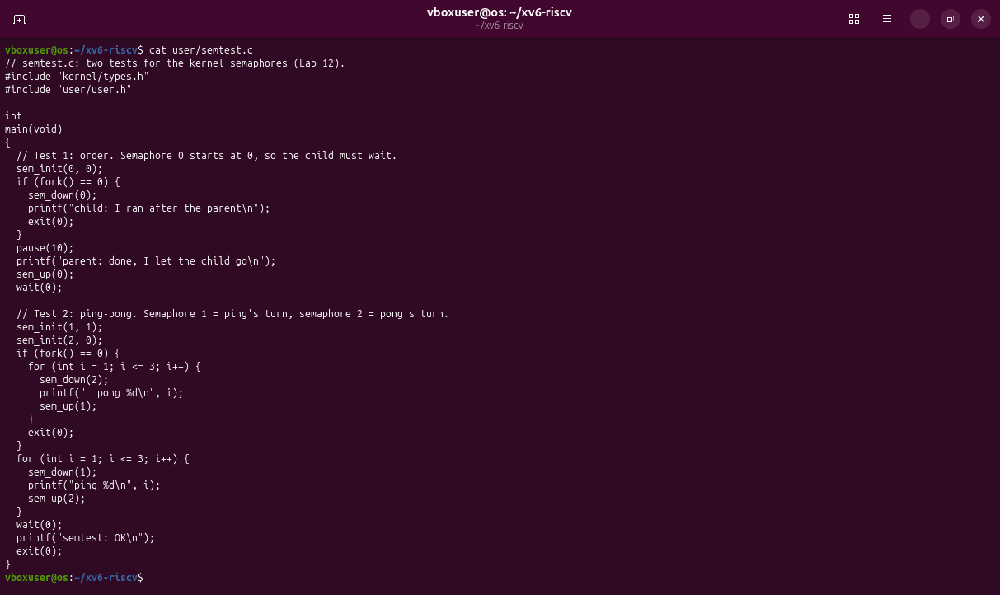

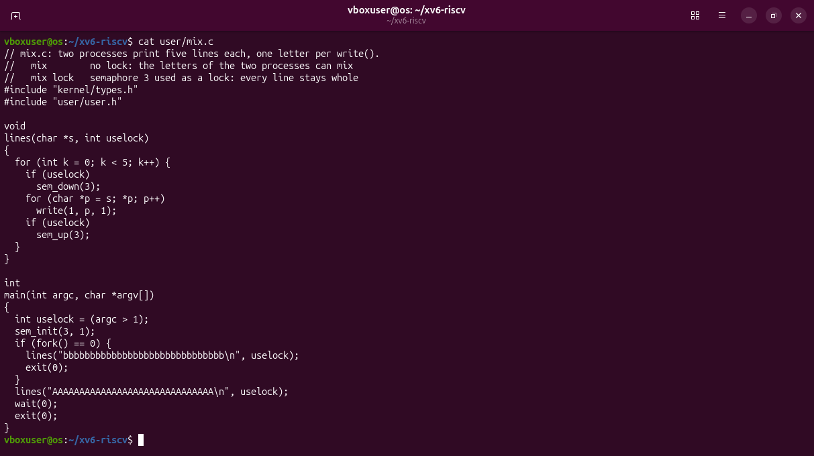

**Check 1.** The calls reach the kernel, but it does not know them yet. The child prints **before** the parent, which is the bug Part 2 fixes.

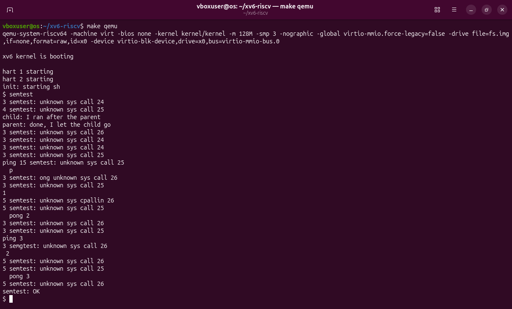

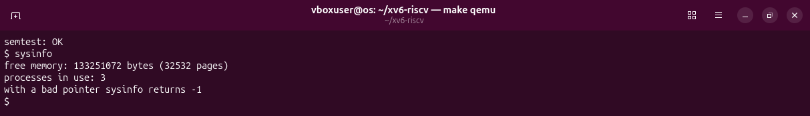

## Part 2 – The kernel side

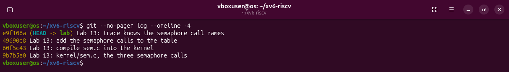

`kernel/sem.c` holds 8 semaphores. Each one is a number and a spinlock that protects it.

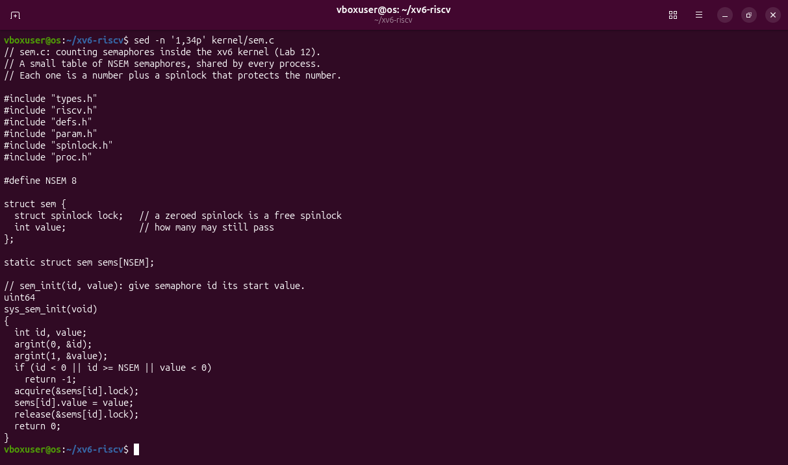

`sem_down` is the heart. While the value is 0, the process registers the address of the semaphore, lets go of the spinlock, and sleeps.

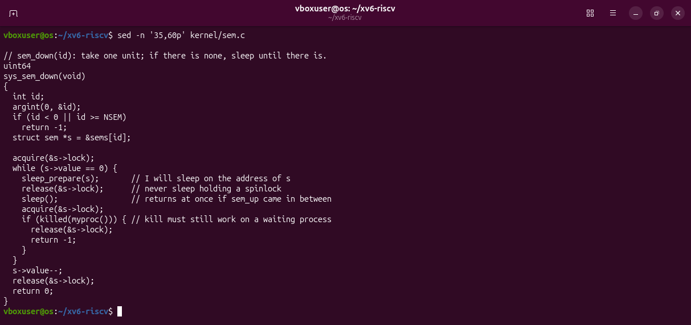

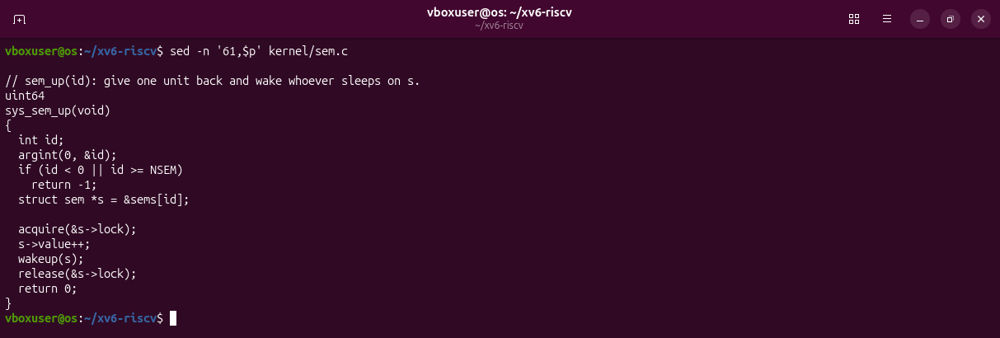

I also added the three names to `syscallnames[]`, so that `trace` from Lab 10 can print them.

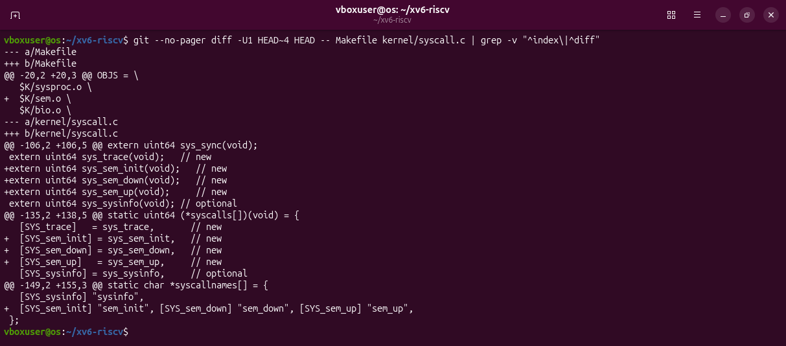

**Check 2.** The parent waits 10 ticks, and the child still prints second, because it was asleep in `sem_down`. Ping and pong alternate.

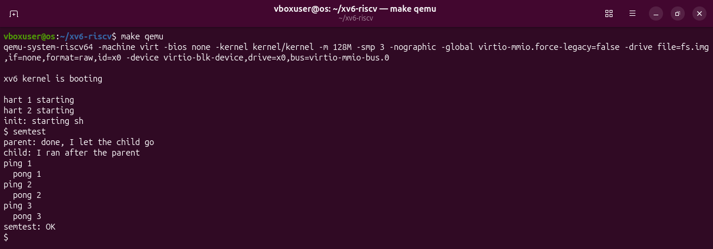

## Part 3 – A semaphore as a lock: mix

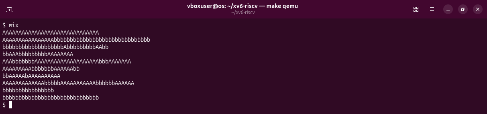

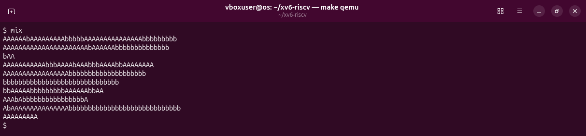

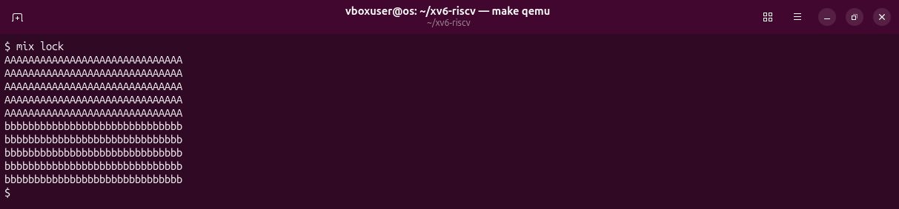

For Observe 4, I tried the mistake for real, in a **separate copy** of the tree: I deleted the `release` before `sleep()`.

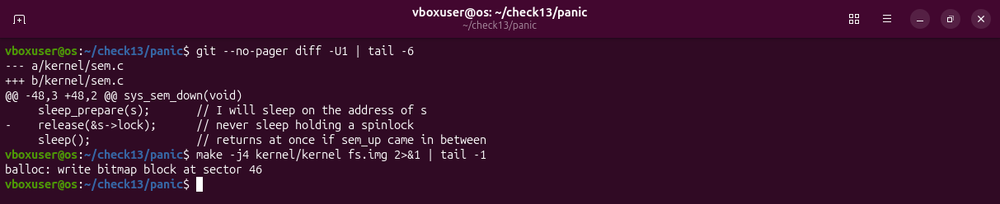

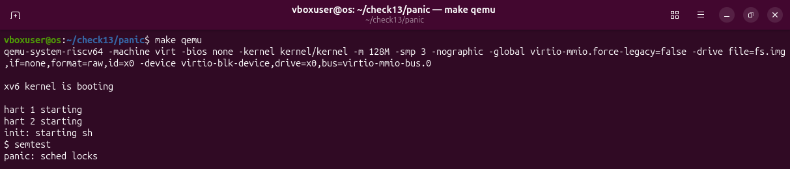

**Observe.**

1. One line costs 31 `write()` calls, 30 letters and the new line. Between two calls the other process, on another CPU, can write its own letter.
2. `sem_down(3);` before the inner `for`, and `sem_up(3);` after it.
3. `wakeup(s)` wakes every process sleeping on `s`, but `sem_up` added only one unit. The first one takes it, and the others find 0 and must sleep again.
4. `sem_up` needs the same spinlock, so nobody could ever wake the sleeper. This kernel stops even earlier: `sched()` panics if a process gives up the CPU while holding another lock.

## Optional – sem_trydown

`sem_trydown(id)`, number 27, is like `sem_down`, but if the value is 0 it returns -1 at once instead of sleeping.

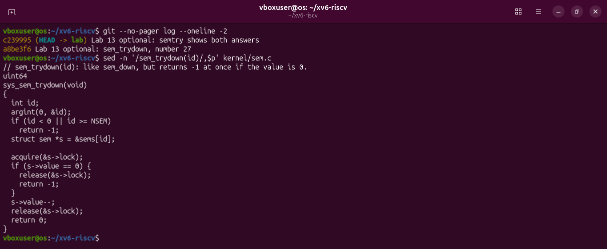

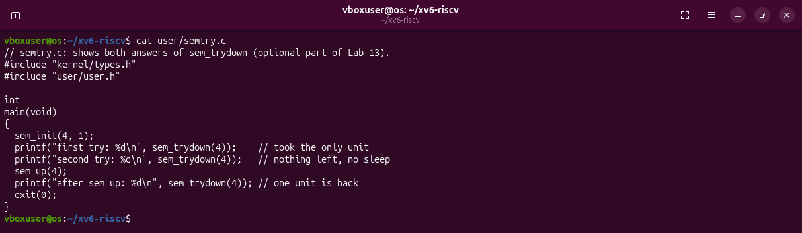

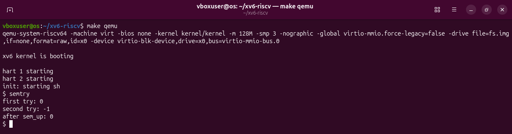

The mask `117440512` is 2^24 + 2^25 + 2^26, the bits of the three semaphore calls.

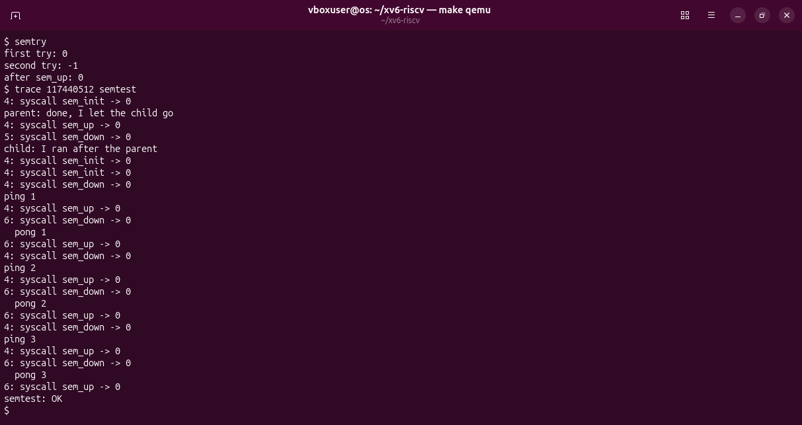

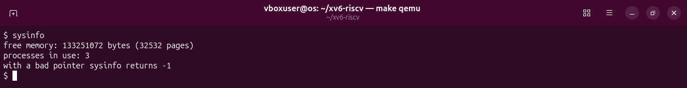

## Conclusions

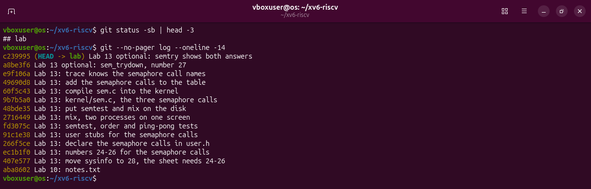

A semaphore is one number, a spinlock that protects it, and the kernel's sleep and wakeup. A waiting process uses no CPU, and the `while` around the sleep keeps it correct when several processes wake at once.
