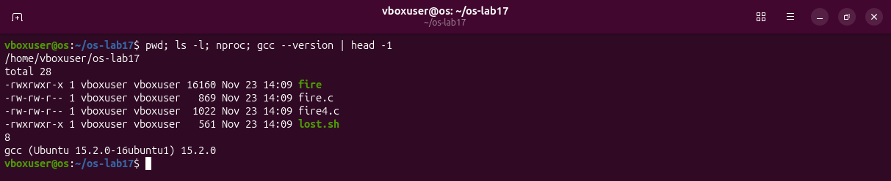
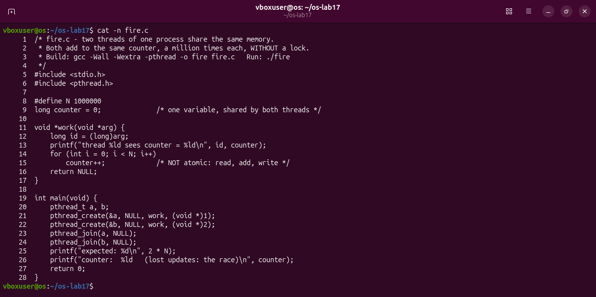
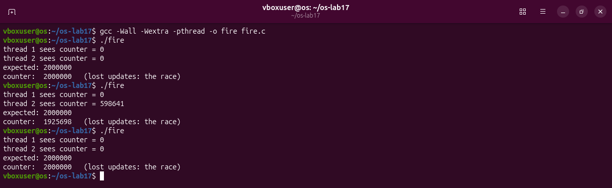
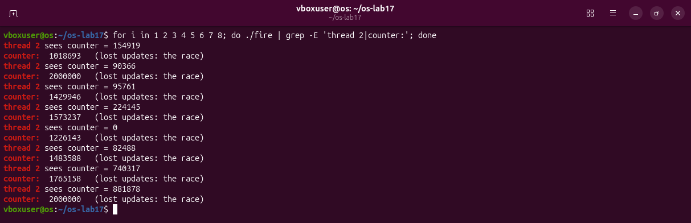
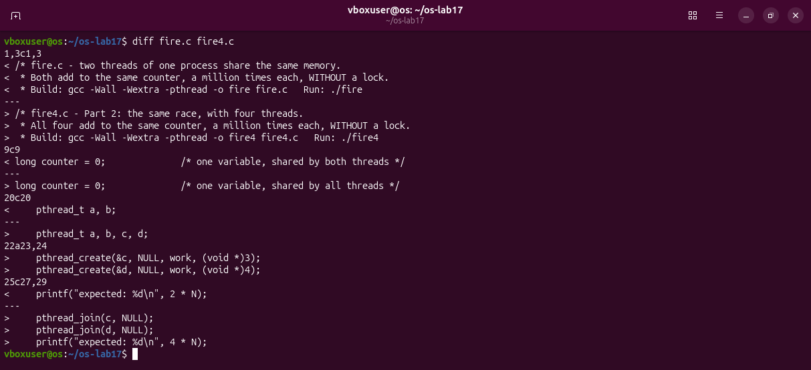
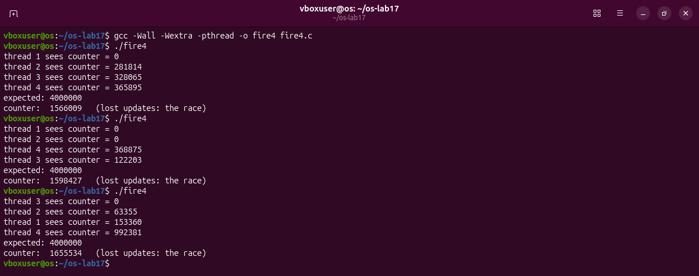
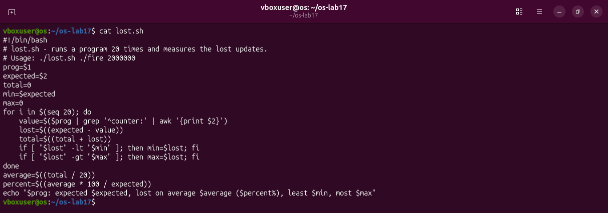
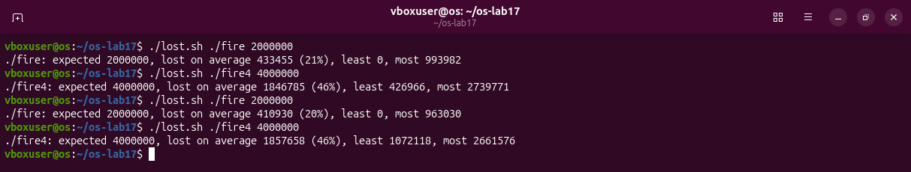

# Lab 17 – Threads Share Memory, and Race

Course: Operating Systems, FCIM / FAF, UTM, 2026-2027. Track A: the real OS, from the outside (Linux).

This page explains everything that was done in the lab, step by step: every command, what it printed, and why. The figure numbers are the same as in the Word report, so the two can be read side by side.

## What is in this folder

| File | What it is |
|---|---|
| `Lab17_EftodeAndrei_FAF-242.docx` | The report: title page, 8 screenshots, the answers to every Observe box |
| `fire.c` | The program of the sheet: two threads, one counter, no lock |
| `fire4.c` | Part 2: the same program with four threads |
| `lost.sh` | A small script: runs a program 20 times and measures the lost updates |
| `report.md` | The answers the sheet asks to write "in report.md" |
| `full_explanations.md` | The slow version of this page: every line, worked examples, a self-test |
| `screenshots/` | The terminal screenshots (`fig-1-1.png` is Figure 1.1, and so on) |

## How to run it

```bash
gcc -Wall -Wextra -pthread -o fire fire.c
./fire
gcc -Wall -Wextra -pthread -o fire4 fire4.c
./fire4
bash lost.sh ./fire 2000000
bash lost.sh ./fire4 4000000
```

## Words used on this page

- **Thread**: one line of execution inside a process. The threads of a process share its memory.
- **Shared variable**: a variable that several threads can read and write, like the global `counter`.
- **Race**: the result depends on which thread happens to run when.
- **Lost update**: an addition that ran, but whose result was overwritten by another thread.
- **Lock (mutex)**: lets only one thread at a time run a piece of code.

## Preparation

The working folder holds the programs. The VM has 8 CPUs, so the threads really run at the same moment.



## Part 1 – Shared and racing

`fire.c` starts two threads. Each one prints the counter it sees, then adds 1 to it, one million times. Nothing protects the counter.



It compiles with no warnings. In the second run, thread 2 starts by printing 598641, and the final result is 1925698 instead of 2000000.



Eight more runs, showing only thread 2's first line and the result. Six runs lose updates. Two are exactly right, by luck.



**Observe 1. What does the non-zero value prove?** Thread 2 prints a number it never wrote. Only thread 1 could have put it there, so both threads see the same memory.

**Observe 2. Why is the result too small, and different each run?** `counter++` is three steps: read, add 1, write.

| Step | Thread 1 | Thread 2 | counter in memory |
|---|---|---|---|
| 1 | reads 5 | | 5 |
| 2 | | reads 5 | 5 |
| 3 | adds 1, writes 6 | | 6 |
| 4 | | adds 1, writes 6 | 6 |

Two additions ran, but the counter grew by 1. The scheduler times the threads differently at each run, so the number of collisions changes.

**Different from the sheet.** The sheet says the result is always less than 2000000. On this VM some runs are exact, because the loop takes only a few milliseconds and the two loops sometimes do not overlap. The bug is still there.

## Part 2 – Make it worse, then think

`fire4.c` adds two more threads. `diff` shows every line that changed.



With four threads, only about 1.6 million of the 4 million additions survive.



One run proves little, so `lost.sh` runs a program 20 times and prints the average loss.



Two rounds for each program:



**Does the loss get bigger?** Yes. Two threads lose about 20% of the updates, four threads about 46%.

**Observe 3. What single idea stops the lost updates?** A lock (mutex) around `counter++`, so that only one thread at a time can do the read, the add and the write.

## Conclusions

Threads are useful because they see the same memory at once, and that is also what makes them dangerous. A line as small as `counter++` is really three steps, and when threads mix those steps, updates disappear. A few lucky runs also showed that one correct result proves nothing.
