# Lab 18 – Build a User-Level Thread Switch

Course: Operating Systems, FCIM / FAF, UTM, 2026-2027. Track B: build your own small OS (xv6).

This page explains everything that was done in the lab, step by step: every change, what it printed, and why. The figure numbers are the same as in the Word report, so the two can be read side by side.

## What is in this folder

| File | What it is |
|---|---|
| `Lab18_EftodeAndrei_FAF-242.docx` | The report: title page, 13 screenshots, the answer to the Observe box |
| `user/uthread.c` | The thread library and the three test threads |
| `user/uthread_switch.S` | `thread_switch`, in assembly: saves and loads the registers |
| `Makefile` | Puts `uthread` on the disk and links it with the assembly file |
| `lab18.patch` | The 7 commits of this lab as one file |
| `notes.txt` | The answer the sheet asks to write "in notes.txt" |
| `full_explanations.md` | The slow version of this page: every line, a full walk-through, a self-test |
| `screenshots/` | The terminal screenshots (`fig-1-1.png` is Figure 1.1, and so on) |

The other files in `kernel/` and `user/` come from Labs 4, 6, 8, 10 and 13. They are here because the Makefile also builds them. This lab does not change the kernel.

## How to run it

```bash
git clone https://github.com/mit-pdos/xv6-riscv && cd xv6-riscv
git checkout 06aad25
cp -r ../lab18/kernel ../lab18/user ../lab18/Makefile .
make qemu
# inside xv6:
uthread
# leave QEMU with Ctrl-A, then x
```

## Words used on this page

- **User-level thread**: a thread made and switched by the program itself. The kernel does not know it exists.
- **Register**: a tiny, very fast storage place inside the CPU.
- **`ra` (return address)**: the register that holds where a function goes back to.
- **`sp` (stack pointer)**: the register that holds the top of the current stack.
- **Callee-saved registers**: `s0` to `s11`, plus `sp`. A function must give them back unchanged.
- **Context**: the saved registers of a thread that is not running.
- **Yield**: a thread gives the CPU to the next thread by itself.

## Before the lab

The course check passes, and the xv6 tree is clean at the last commit of Lab 13.

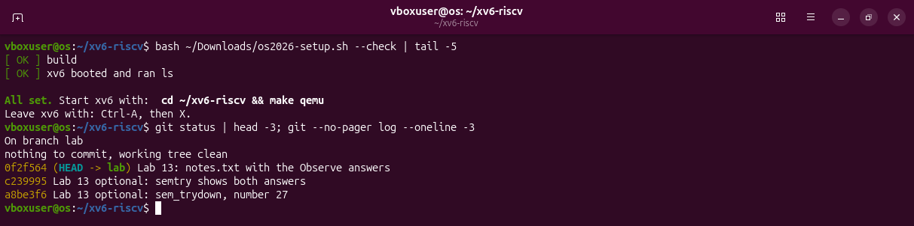

## Part 1 – The switch

### 1.1 `user/uthread.c`

The file starts from the skeleton of the sheet. `thread_b` and `thread_c` are copies of `thread_a`, as the sheet asks. Three TODO places remain.

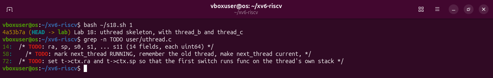

**TODO 1.** The context holds the 14 registers a thread must keep.

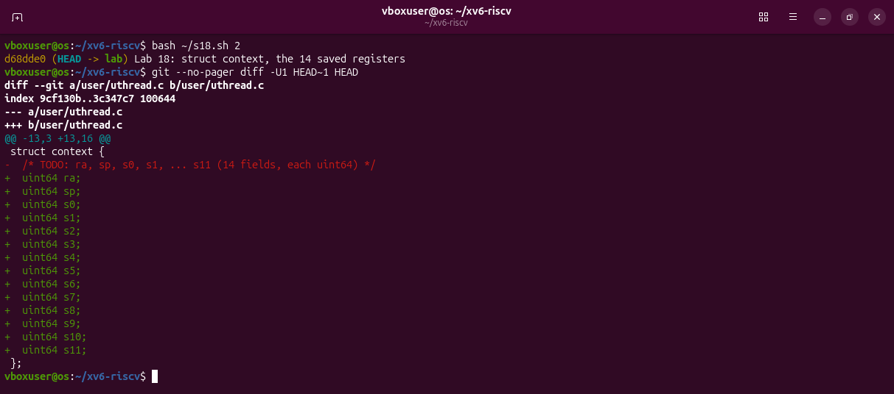

**TODO 2.** A new thread has never run, so `thread_create` prepares its registers by hand. `ra` is the function it will start in, and `sp` is the top of its own stack, because a stack grows down.

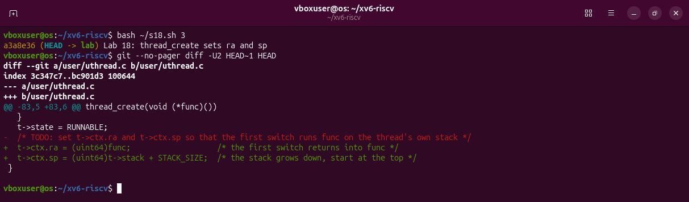

**TODO 3.** `thread_schedule` marks the next thread as running, makes it the current one, and calls the switch. It keeps the old thread in `old`, because `current_thread` has already changed.

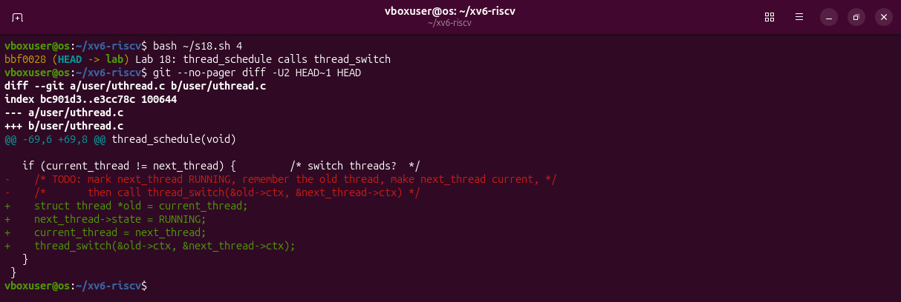

### 1.2 `user/uthread_switch.S`

`a0` is the first argument, the old context. `a1` is the second, the new context. The function stores 14 registers, loads 14 registers, and returns.

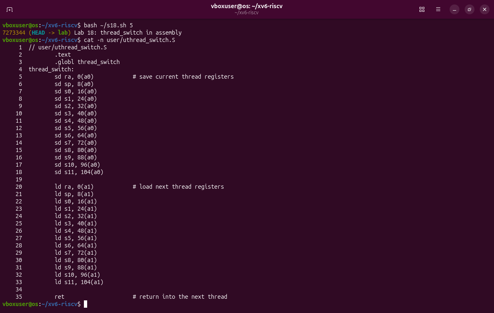

### 1.3 `Makefile`

`_uthread` joins `UPROGS`, so it lands on the xv6 disk. The new rule links two object files, `uthread.o` and `uthread_switch.o`, because the normal rule links only one.

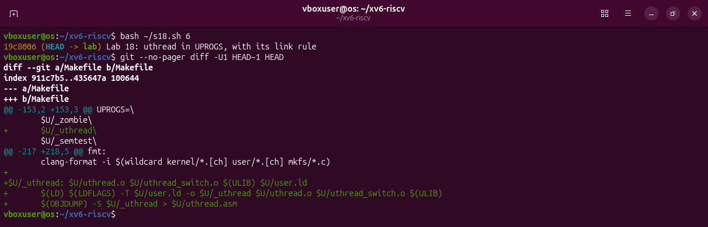

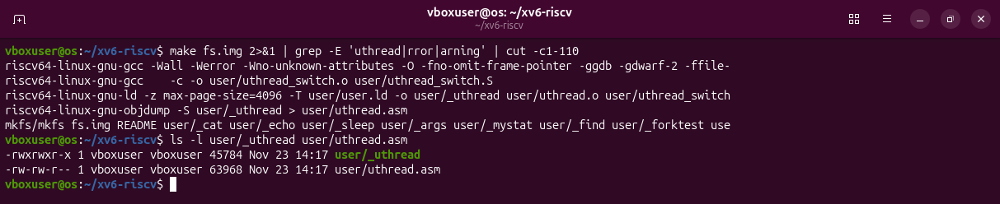

## Part 2 – Run it

The three threads start, then take turns: c, a, b, c, a, b, and so on.

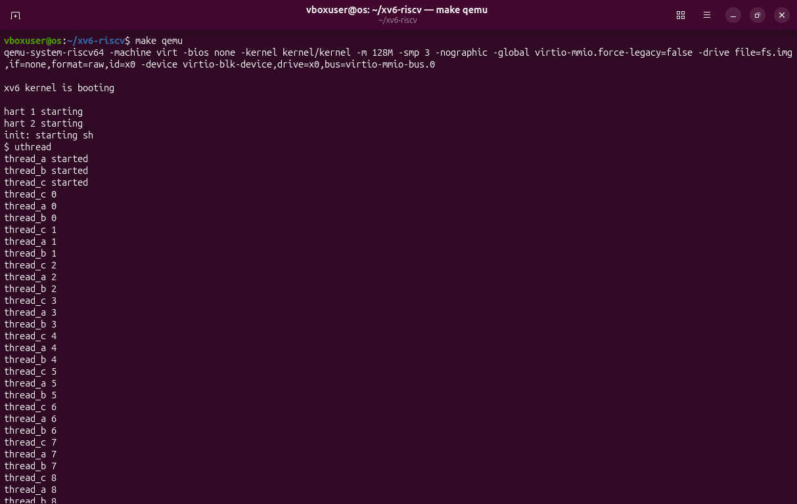

Each thread counts to 99 and exits after 100 lines. The last message is expected: all threads are finished, so the scheduler has nobody left to run.

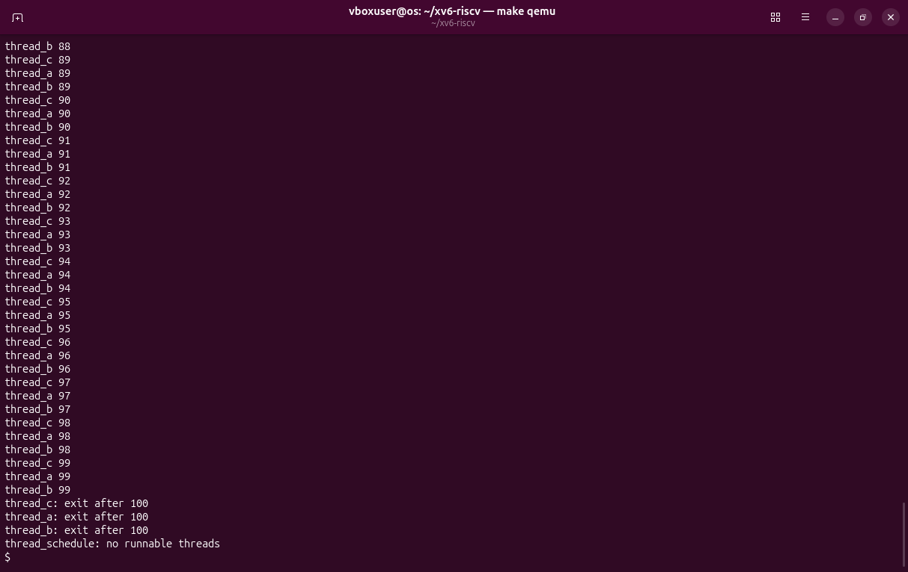

A small script ran `uthread` again and compared all 300 lines with the expected order. They match.

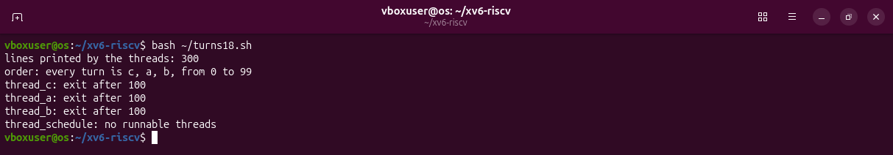

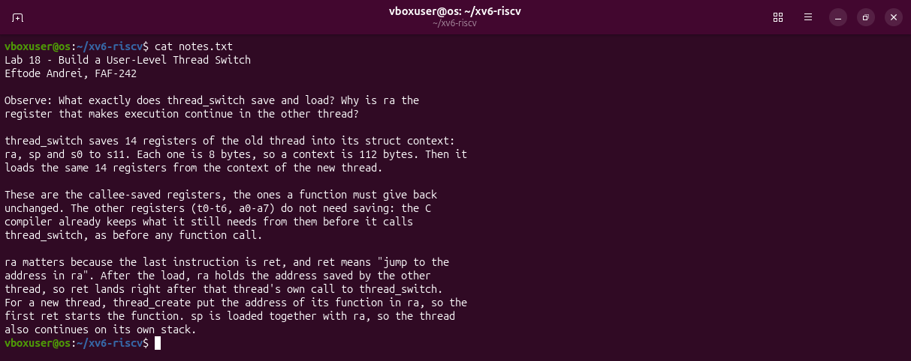

**Observe. What does `thread_switch` save and load, and why is `ra` the key?** It saves `ra`, `sp` and `s0` to `s11` of the old thread, then loads the same 14 registers of the new thread. The final `ret` jumps to the address in `ra`. That address now belongs to the other thread, so execution continues there. For a new thread, it is the start of its function.

## Conclusions

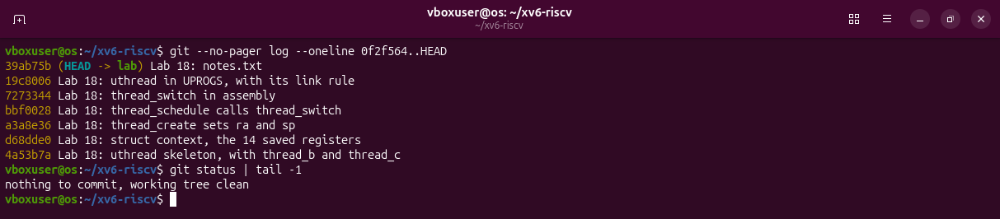

A thread switch copies 14 registers out, copies 14 registers in, and returns. Because `ra` and `sp` changed, that return lands in another thread, on another stack. The threads take turns only when they call `thread_yield`, and the kernel never knows they exist.
