# Lab 9 – Watching System Calls with strace

Course: Operating Systems, FCIM / FAF, UTM, 2026-2027. Track A: the real OS, from the outside (Linux).

This page explains everything that was done in the lab, step by step: every command, what it printed, and why. The figure numbers are the same as in the Word report, so the two can be read side by side.

## What is in this folder

| File | What it is |
|---|---|
| `Lab9_EftodeAndrei_FAF-242.docx` | The report: title page, 15 screenshots, the answers to every Observe box |
| `syscalls.c` | The program of the sheet: `open`, `write`, `read` and `close` used directly (exactly the code of the sheet) |
| `report.md` | The answers the sheet asks to write "in report.md", with the real outputs |
| `full_explanations.md` | The slow version of this page: how a system call works, every line of `syscalls.c`, every line of the traces, buffering, worked examples and a self-test |
| `screenshots/` | The terminal screenshots shown on this page (`fig-1-1.png` is Figure 1.1, and so on) |

The PDF of the sheet I received has only two pages: Part 3 ("Count one kind of call") has a title but no instructions. I did it with `strace -c`, which is the option of `strace` that counts calls (see Part 3 below).

## How to run it

```bash
sudo apt install strace                  # only if it is missing
mkdir -p ~/os-lab9 && cd ~/os-lab9       # put syscalls.c here
# Part 1
cd ~ && strace -f -e trace=openat,read,write,close ls -l
# Part 2
cd ~/os-lab9
gcc -Wall -Wextra -o syscalls syscalls.c && ./syscalls
strace -e trace=openat,write,read,close ./syscalls
# Part 3
strace -c ls -l > /dev/null
strace -c -e trace=write ./syscalls
strace -c -e trace=write ./syscalls > out.txt
```

## Words used on this page

- **Kernel**: the core of the operating system. Only the kernel touches the disk, the screen, the memory of other programs. A normal program has to **ask** it.
- **System call**: such a request. The program puts a number (which service) and some arguments in registers and executes one special instruction that jumps into the kernel. Examples: `openat` (open a file), `read`, `write`, `close`, `execve` (start a program).
- **`strace`**: a Linux tool that runs a program and prints every system call it makes, with the arguments and the result. It is like a recording of every request the program sent to the kernel.
- **File descriptor**: a small number that stands for an open file, like a ticket number. Every process starts with three: **0** = standard input (keyboard), **1** = standard output (screen), **2** = standard error (screen). `open` gives the next one.
- **`printf`**: a function of the C library, **not** a system call. It collects text in a buffer and calls `write` when it decides to.
- **Buffer**: a piece of memory where data waits before it is sent all at once.
- **`/dev/pts/0`**: the terminal window I type in, seen as a file. Writing to it puts text on the screen.

## Before the lab

```bash
mkdir -p ~/os-lab9 && cd ~/os-lab9 && pwd
uname -sr; gcc --version | head -1
dpkg -s strace | grep -E '^(Status|Version)'
which strace && strace -V | head -1
```

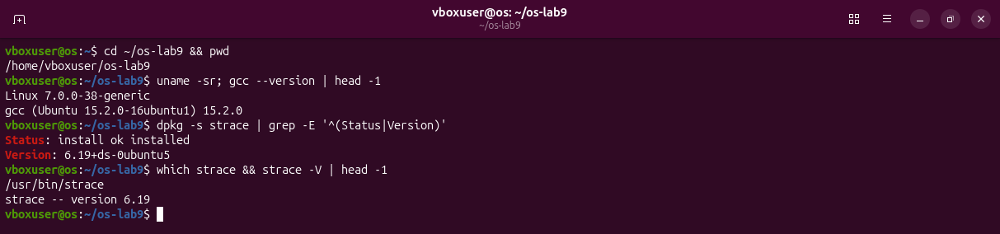

- `uname -sr` prints the kernel: Linux 7.0.0-38. `gcc` is 15.2.0.
- `dpkg -s strace` asks the package manager about the package `strace`: "install ok installed", version 6.19. So `sudo apt install strace` was not needed.
- `which strace` prints where the program is (`/usr/bin/strace`).

## Part 1 – See the calls of a real command

```bash
cd ~
strace -f -e trace=openat,read,write,close ls -l
```

- `strace` runs `ls -l` and prints its system calls to the screen (on standard error, so they mix with the normal output of `ls`).
- `-f` ("follow") also traces child processes, if the program makes any. `ls` makes none, but the option costs nothing.
- `-e trace=openat,read,write,close` keeps only these four kinds of calls; without it, there would be about 320 lines.
- I ran it in my home folder, which has 21 entries, so that `ls -l` has something to print.

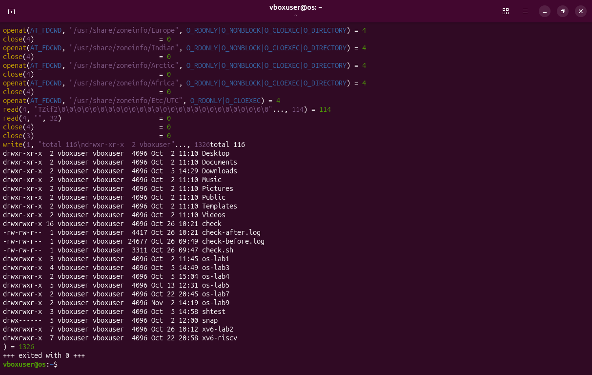

Each line is one system call: its name, its arguments in brackets, then `=` and the result. `openat(..., "/usr/share/zoneinfo/Europe", ...) = 4` means: "open this folder", and the kernel answered "it is descriptor 4". `close(4) = 0` means: "close descriptor 4", and 0 means success.

The interesting line is near the bottom: `write(1, "total 116\ndrwxr-xr-x  2 vboxuser"..., 1326`. `ls` asks the kernel to write 1326 bytes to descriptor 1. `strace` prints the start of that line **before** the call runs, then the kernel puts the listing on the screen, and only then `strace` finishes the line with `) = 1326` (all 1326 bytes were written). That is why the listing appears in the middle of the line.

The beginning of the output scrolled away, so I saved the same trace to a file with `-o` and looked at its first lines:

```bash
strace -o ~/os-lab9/ls-l.trace -f -e trace=openat,read,write,close ls -l > /dev/null
head -n 34 ~/os-lab9/ls-l.trace
```

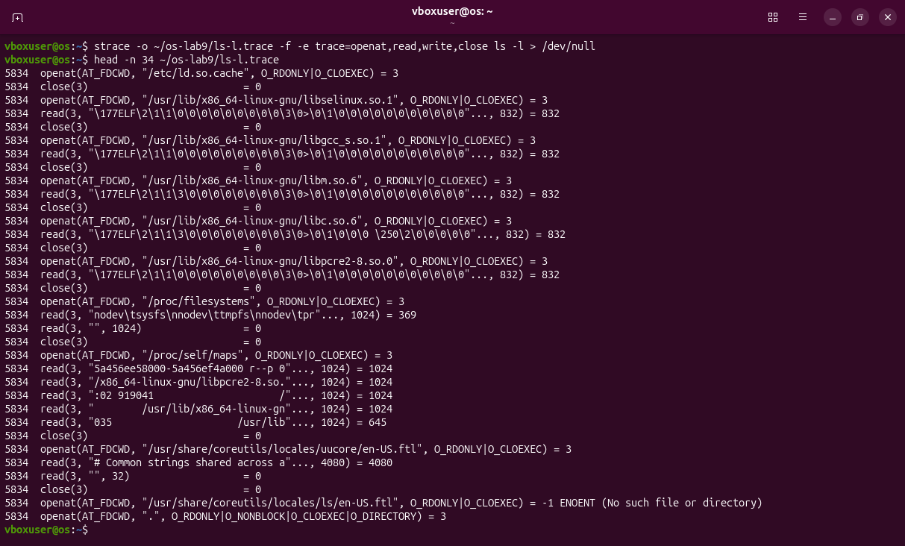

- With `-o file` the trace goes into the file, and `> /dev/null` throws away the listing itself. With `-f` and `-o`, each line starts with the PID (5834).
- `/etc/ld.so.cache` is the index of the libraries. Then five libraries are opened, and of each one only the first 832 bytes (the ELF header, `\177ELF...`) are read; the rest is mapped into memory with `mmap`, which is not in my filter.
- `/proc/filesystems` is read by `libselinux`; `/proc/self/maps` is the memory map of the process itself.
- `en-US.ftl` are the message files of `ls`: on Ubuntu 26.04 `ls` is the Rust rewrite of the coreutils ("uutils"). The second one does not exist: `-1 ENOENT (No such file or directory)`. A failed call is still a call.
- `openat(AT_FDCWD, ".", ...)` = 3 is the folder to list.

Then I counted:

```bash
wc -l ~/os-lab9/ls-l.trace
grep -v '+++' ~/os-lab9/ls-l.trace | awk '{print $2}' | cut -d'(' -f1 | sort | uniq -c
grep ' write(' ~/os-lab9/ls-l.trace
strace -f -o ~/os-lab9/ls-l-all.trace ls -l > /dev/null
wc -l ~/os-lab9/ls-l-all.trace
tail -n 2 ~/os-lab9/ls-l-all.trace
ls -l /proc/$$/fd
```

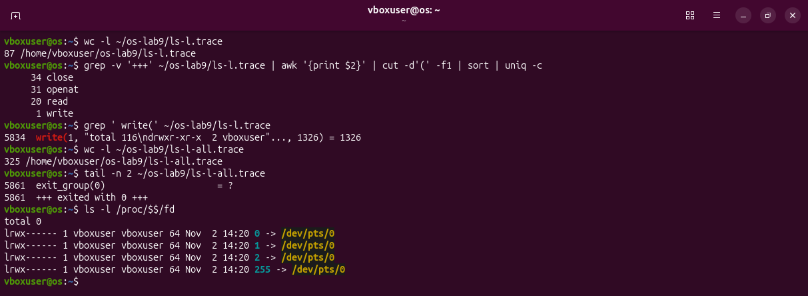

- `wc -l` counts lines: 87, the last one being `+++ exited with 0 +++`, so 86 calls.
- The long pipeline counts each kind: `grep -v '+++'` drops the last line, `awk '{print $2}'` keeps the second word (`openat(AT_FDCWD,`), `cut -d'(' -f1` keeps what is before the bracket (`openat`), `sort | uniq -c` counts equal lines. Result: 34 `close`, 31 `openat`, 20 `read`, **1 `write`**.
- The second trace has no `-e` filter: 325 lines, so 324 system calls of every kind (the last one, `exit_group`, never returns: `= ?`).
- `$$` is the PID of my shell; `/proc/<pid>/fd` lists its open descriptors: 0, 1 and 2 all point to `/dev/pts/0`, my terminal.

### Answer

**Which system call does ls use to print to the screen? To which descriptor does it write?** `write`, to descriptor 1 (standard output), which is the terminal `/dev/pts/0`. One simple `ls -l` makes 86 calls of the four kinds and about 320 in all; it prints its whole listing with a single `write`.

## Part 2 – A program that calls the kernel directly

The sheet gives the program; I typed it in nano:

```c
/* syscalls.c - open, write, read and close, using only system calls.
 * Build:  gcc -Wall -Wextra -o syscalls syscalls.c
 * Run:    ./syscalls
 * See the calls: strace ./syscalls
 */
#include <fcntl.h>      /* open */
#include <unistd.h>     /* write, read, close */
#include <string.h>     /* strlen */
#include <stdio.h>      /* printf */

int main(void) {
    const char *msg = "hello, kernel\n";

    /* open() is a system call: ask the kernel for a file, get back a descriptor */
    int fd = open("note.txt", O_CREAT | O_WRONLY | O_TRUNC, 0644);
    if (fd < 0) { perror("open"); return 1; }
    printf("open returned descriptor %d\n", fd);

    /* write() is a system call: hand the bytes to the kernel */
    ssize_t n = write(fd, msg, strlen(msg));
    printf("write sent %zd bytes\n", n);
    close(fd);

    /* read it back, through the kernel again */
    fd = open("note.txt", O_RDONLY);
    char buf[64];
    n = read(fd, buf, sizeof(buf) - 1);
    buf[n] = '\0';
    printf("read got %zd bytes: %s", n, buf);
    close(fd);
    return 0;
}
```

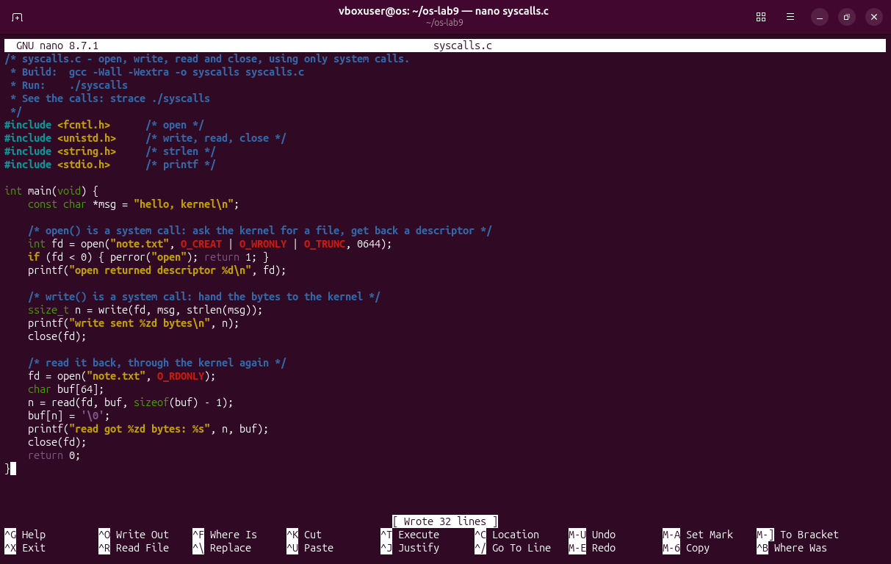

In short: open `note.txt` for writing (create it if needed, empty it if it exists), write the 14 bytes of `"hello, kernel\n"` into it, close it, open it again for reading, read up to 63 bytes, close it. The three `printf` lines report what each call returned. Every line is explained in [full_explanations.md](full_explanations.md#5-part-2-syscallsc-line-by-line).

```bash
gcc -Wall -Wextra -o syscalls syscalls.c
ls -l
./syscalls
cat note.txt
```

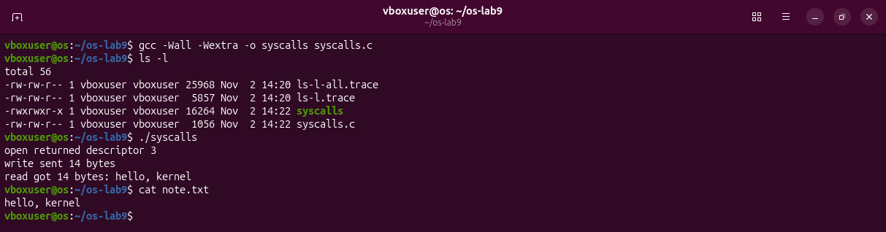

The compiler prints nothing, so there is no warning. The output is the one the sheet expects: descriptor 3, 14 bytes written, 14 bytes read back.

```bash
strace -e trace=openat,write,read,close ./syscalls
```

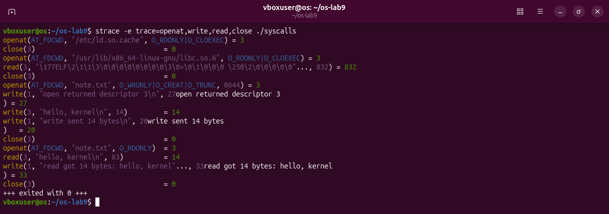

The first five lines belong to the loader (it opens the library index and `libc.so.6`, the C library, also as descriptor 3, and closes it). Then come my calls. Because both `strace` and my program print on the same terminal, the lines are mixed again, so I saved the trace in a file:

```bash
strace -o syscalls.trace -e trace=openat,write,read,close ./syscalls
cat syscalls.trace
```

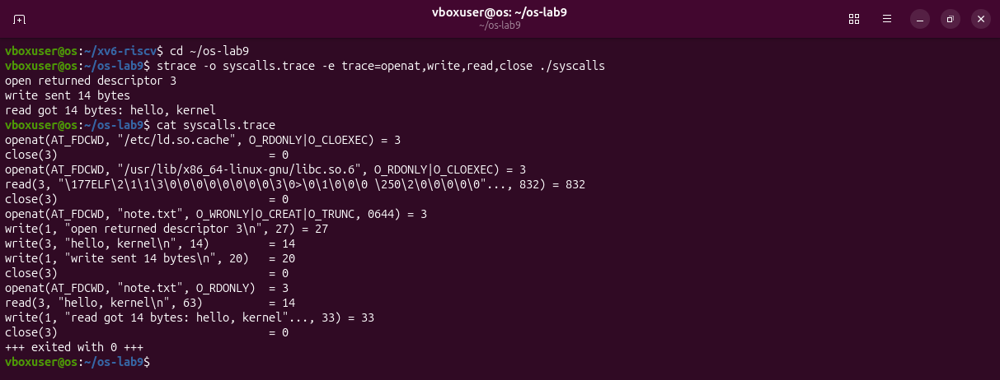

Line by line, my program as the kernel sees it:

| My C code | The system call | Result |
|---|---|---|
| `open("note.txt", O_CREAT \| O_WRONLY \| O_TRUNC, 0644)` | `openat(AT_FDCWD, "note.txt", O_WRONLY\|O_CREAT\|O_TRUNC, 0644)` | 3 |
| `printf("open returned descriptor %d\n", fd)` | `write(1, "open returned descriptor 3\n", 27)` | 27 |
| `write(fd, msg, strlen(msg))` | `write(3, "hello, kernel\n", 14)` | 14 |
| `printf("write sent %zd bytes\n", n)` | `write(1, "write sent 14 bytes\n", 20)` | 20 |
| `close(fd)` | `close(3)` | 0 |
| `open("note.txt", O_RDONLY)` | `openat(AT_FDCWD, "note.txt", O_RDONLY)` | 3 |
| `read(fd, buf, sizeof(buf) - 1)` | `read(3, "hello, kernel\n", 63)` | 14 |
| `printf("read got %zd bytes: %s", n, buf)` | `write(1, "read got 14 bytes: hello, kernel"..., 33)` | 33 |
| `close(fd)` | `close(3)` | 0 |

- The C function `open` becomes the system call `openat` with `AT_FDCWD` ("relative to the current folder"): on Linux the C library implements `open` with `openat`.
- The second `open` gets 3 again, because `close(3)` freed it.
- `read` asks for 63 bytes (`sizeof(buf) - 1`, one byte is kept for the `'\0'`) and gets 14: the file has only 14.

Why 3? Two experiments:

```bash
ls -l /proc/self/fd
./syscalls <&-
```

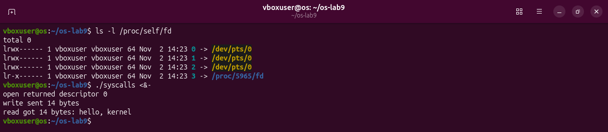

- `/proc/self/fd` shows the descriptors of the process that reads it (here `ls` itself): 0, 1, 2 are `/dev/pts/0`, and 3 is the folder `ls` has just opened to read the list. So `ls` also got 3 for its first `open`.
- `<&-` tells bash to start the program with descriptor 0 **closed**. Now the smallest free descriptor is 0, and `open` returns 0. The rest of the program works the same way, with descriptor 0 instead of 3.

### Answer

**The descriptor returned by the first openat is 3, not 0, 1 or 2. Why are those three already taken?** 0, 1 and 2 are standard input, standard output and standard error. The shell opened them on the terminal, and every program it starts gets them through `fork` and `exec`, before `main` runs. The kernel always gives the smallest free descriptor, and the smallest free one is 3. With descriptor 0 closed, the same `open` returns 0 (Figure 2.5).

## Part 3 – Count one kind of call

The sheet gives only the title of this part. `strace -c` is the counting mode of `strace`: instead of printing every call, it prints at the end a table with how many times each kind of call was made (`calls`), how many failed (`errors`) and the time spent.

```bash
cd ~
strace -c -S calls -o ~/os-lab9/ls-l.count ls -l > /dev/null
head -n 14 ~/os-lab9/ls-l.count; tail -n 2 ~/os-lab9/ls-l.count
strace -c -e trace=openat ls -l > /dev/null
```

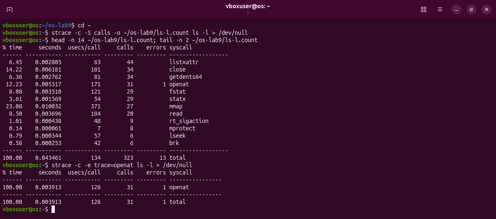

- `-S calls` sorts the table by the number of calls; `-o` puts the table into a file, and I show its first 12 rows and the total line.
- 323 calls in total, 13 of them failed. The most frequent is `listxattr` (44): for every entry `ls -l` asks for its "extended attributes", to know whether to print a `+` after the permissions. `statx` (29) gets size, owner and date of each entry; `getdents64` (34) reads the entries of a folder. **`write`: 1.**
- `-e trace=openat` together with `-c` counts one kind only: 31 `openat`, 1 error (the missing message file of Figure 1.2).

Then one kind, `write`, in my own program:

```bash
cd ~/os-lab9
strace -c -e trace=write ./syscalls
strace -c -e trace=write ./syscalls > out.txt
cat out.txt
```

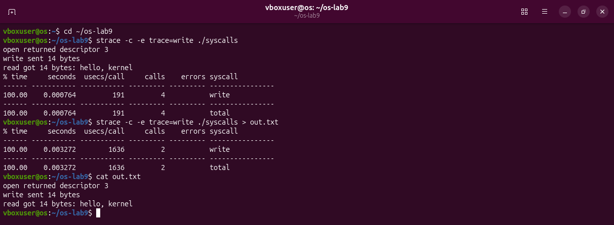

The same program, the same output (`cat out.txt` shows the three lines), but 4 `write` calls on the terminal and only **2** into a file. To see which two:

```bash
strace -e trace=write ./syscalls > out.txt
seq 1 100000 | wc -c
strace -c -e trace=write seq 1 100000 > /dev/null
strace -e trace=write seq 1 100000 2>&1 > /dev/null | head -n 3
```

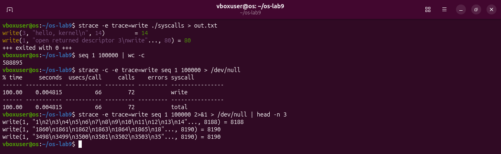

- Into the file, the three `printf` lines leave together, in **one** `write(1, ..., 80)` at the end of the program. My own `write(3, "hello, kernel\n", 14)` is there as always.
- `seq 1 100000` prints the numbers 1 to 100000, 588 895 bytes. It needs only **72** `write` calls, about 8190 bytes each. (In the last command, `2>&1 > /dev/null` sends the trace into the pipe and the numbers into `/dev/null`; the order of the two redirections matters.)

All the calls of my program, not only mine:

```bash
strace -c ./syscalls > /dev/null
```

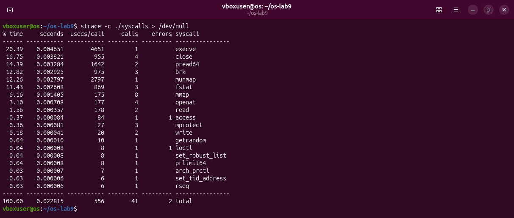

41 system calls of 19 kinds. Mine are 6 (2 `openat`, 1 `write`, 1 `read`, 2 `close`), plus 1 `write` from `printf`. The rest is the loader and the C library getting ready: `execve` (start the program), `mmap` and `mprotect` (map the library into memory), `brk` (memory for the buffer of `printf`) and so on. One `ioctl` failed; the last experiment shows why:

```bash
strace -e trace=fstat,ioctl ./syscalls
strace -e trace=fstat,ioctl ./syscalls > out.txt
strace -e trace=fstat,ioctl ./syscalls > /dev/null
```

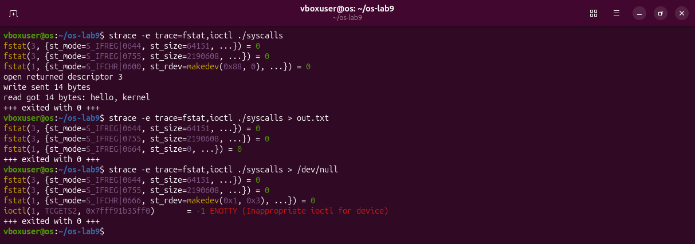

Before the first `printf` goes out, the C library looks at descriptor 1 with `fstat(1, ...)`:

- On the terminal it is a character device (`S_IFCHR`) with number `0x88, 0`: 0x88 = 136 is the number Linux gives to terminal windows (`/dev/pts/...`). So: line buffering, one `write` per line.
- Into `out.txt` it is a regular file (`S_IFREG`): full buffering, one `write` at the end.
- `/dev/null` is a character device too (`0x1, 0x3`), but not a terminal one, so the library asks the kernel directly with `ioctl(1, TCGETS2, ...)`, "give me your terminal settings". The kernel answers `ENOTTY`, "not a terminal": full buffering. That is the 1 error of Figure 3.4.

### Answers (my own questions, since the sheet gives none)

1. **Which call does `ls -l` make most?** `listxattr` (44 of 323). Collecting information (`listxattr`, `statx`, `getdents64`) and loading libraries cost far more calls than printing, which is 1 call.
2. **Why 4 writes on the terminal and 2 into a file?** `printf` is not a system call: it fills a buffer of the C library. On a terminal the buffer is sent at every `\n` (3 writes); into a file, once at the end (1 write). The library decides with `fstat(1)`. My own `write` is always exactly one call.
3. **Why does `seq` use so few writes?** Every system call is a trip into the kernel and back, which costs time, so programs collect output and write it in big pieces (about 8 KB).

## Deliverables

```bash
ls -l
head -n 12 report.md
```

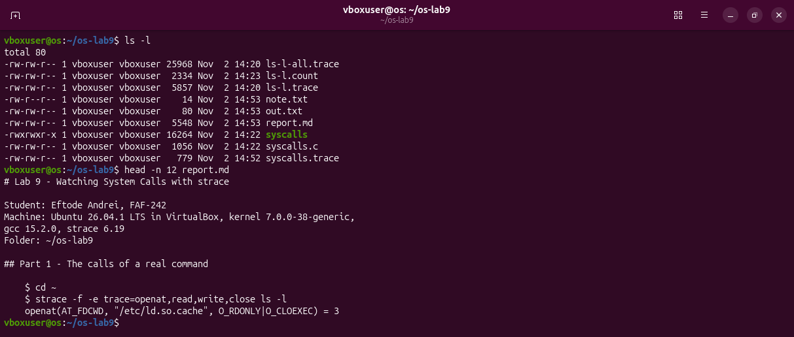

`report.md` holds the answers and the real outputs, as the sheet asks. I wrote it on Windows and copied it into the VM with `wget`; the copy in this folder is byte-for-byte the same, and so is `syscalls.c`.

## What I learned

- A system call is the only way a program can get something done by the kernel: open a file, write to the screen, read a file. `strace` shows them all, with arguments and results.
- Even a tiny command like `ls -l` makes over 300 system calls; most of them prepare the program and collect information, and only one prints.
- `open` returns the smallest free descriptor; 0, 1 and 2 are already the terminal when a program starts, so the first file is 3.
- `printf` is a library function on top of `write`. The library buffers: one `write` per line on a terminal, one big `write` into a file. Fewer system calls means less time spent going in and out of the kernel.
